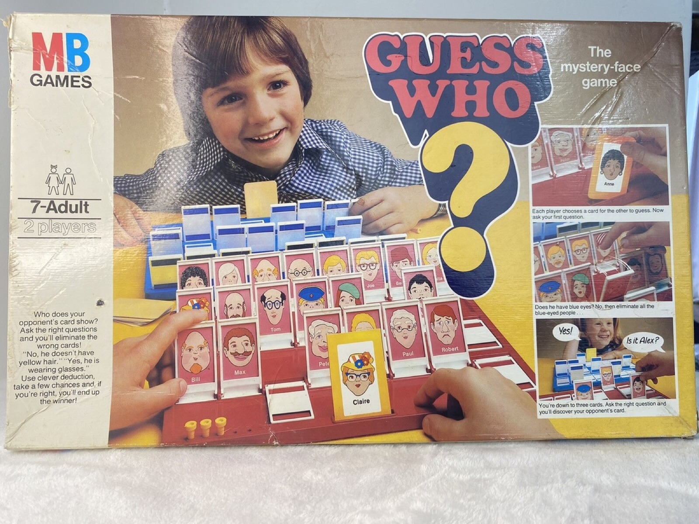

# Intersection Attacks on CoinJoin Anonymity

> Originally published as [The Scroll #4: Intersection Attacks on CoinJoin Anonymity](https://spiralxyz.substack.com/p/the-scroll-4-intersection-attacks) by Yuval Kogman
> ([@not_nothingmuch](https://x.com/not_nothingmuch)) on Spiral,
> 2025-06-11, licensed under [CC BY-SA 4.0](https://creativecommons.org/licenses/by-sa/4.0/).

Like the [previous post in The Scroll series](history-of-wallet-clustering.md), this one accompanies and elaborates on a [video presentation](https://www.youtube.com/watch?v=oQk87s0N3BU).

## Thinking Adversarially about Twenty Questions

When studying privacy, it’s useful to think of deanonymization as a game. We imagine an adversary with some access to information, and it tries to guess correctly who among a set of candidates was responsible for some event in the system. To defend against the adversary winning, we need to keep it guessing, which could either mean limiting its access to information or using randomness to increase the amount of information it needs to succeed.

*Source: **[Guess Who? 1979 edition….Unboxing & Overview](https://www.youtube.com/watch?v=5ifCeqYdTG4)***

Many readers will be familiar with the game of “[Guess Who?](https://en.wikipedia.org/wiki/Guess_Who%3F)”. This game could be described as a turn-based composition of two instances of the more general game of “[twenty questions](https://en.wikipedia.org/wiki/Twenty_questions)”. In “twenty questions”, you secretly choose an element from a given set, and your opponent tries to guess it correctly by asking you up to 20 yes or no questions. In “Guess Who?”, both sides take turns playing against each other, and the first to guess correctly wins. The set of elements is fixed in “Guess Who?”, consisting of 24 cartoon characters with various distinguishing features, such as their hair color or style. Each character has a unique name that unambiguously identifies them.

The answers to a yes or no question can be represented as a bit: a 1 or a 0. Twenty bits can express, in base two, any whole number in the range 0 to 1,048,575, which is 2²⁰-1. If a set can be totally ordered, each element in the set may be indexed by its numbered position in the order, which uniquely identifies it. So, twenty bits can uniquely address one of just over a million elements.

Although 2²⁰ is the maximum number of elements of a set that could be uniquely identified using just the answers to 20 yes or no questions, in real-world situations, 20 answers will often contain less information than that. For most sets and combinations of questions, things will almost certainly not line up perfectly, and not every question will bisect the candidate elements independently of the other questions. The answers to some questions might be biased. Some questions’ answers might correlate with those of other questions.

Suppose that instead of asking something like “does your character have glasses?” you always ask “alphabetically does your character’s name appear before \[median remaining character’s name\]?”. This is a [binary search](https://en.wikipedia.org/wiki/Binary_search), which will maximize how informative the answer to each question will be: at every step, the median name partitions the set of remaining characters, and the question eliminates one of the two halves. Repeatedly halving the remaining candidates will narrow down the search as quickly as yes or no answers make possible, only a logarithmic number of steps is required, which is much faster than say a linear scan (i.e. checking one by one: “Is it Alice? No? How about Bob? …”).

*Source: [Binary search - Wikipedia](https://en.wikipedia.org/wiki/Binary_search#/media/File:Binary_Search_Depiction.svg)*

Bear in mind that if you are playing to win, the point of the game is not to get the most information out of your opponent but to be the first to guess correctly, and it turns out that maximizing the information per answer is actually [not the optimal strategy](https://arxiv.org/pdf/1509.03327) at least when the game is played honestly. Similarly, when using games to study privacy, one must assume the adversary is rational according to its preferences; it’s fairly easy to accidentally optimize for a subtly incorrect outcome. The adversary is playing to win.

Finally, suppose the players are no longer assumed to be honest. It should be apparent that one can cheat undetectably[^1], instead of choosing an element of the set at the start and then answering honestly, in response to every question, you can always give the answer that would leave the largest number of remaining candidates. Adaptively chosen answers can therefore minimize the rate at which one's opponent obtains useful information to win the game. In this so-called Byzantine setting, the optimal strategy is no longer the same as when players are honest. Here, an opponent’s best response would be to stick with binary search, which limits the advantage of playing adaptively.

Adaptive “Guess who?” is pretty boring, similar to how tic-tac-toe should always end in a draw if you’re paying attention. To be precise, as we will see in the next section, there are 4.58 bits of information to extract from your maximally adversarial opponent, and the rules of the game can be used to force the opponent to commit to those bits. This means the first player can always win after five questions. The transcript of answers in such games should always consist of uniformly random bits[^2]; anything else would give an edge to one’s opponent. Unfortunately, privacy protections using such adaptivity or added randomness are difficult to build and understand, so actual privacy software is usually significantly harder to analyze than these toy examples.

## Measuring Anonymity

### Shannon Entropy

The [information content](https://en.wikipedia.org/wiki/Information_content) of an answer in “Guess Who?”, also known as its Shannon entropy, quantifies how surprising it is to learn. For example, if you already found out that your opponent’s character is bald, it won’t surprise you to learn that they do not have black hair, and this answer contains no additional information. This wasn’t surprising because, before being told, you could infer that the probability of having black hair was zero.

Suppose that two options remain from the set of candidates; it’s basically a coin toss, and either of the two options should be equally likely and, therefore, equally surprising. Learning that it’s option A tells you it isn’t B, and equivalently, learning that it’s not B tells you that it must be A, so only one yes or no question is needed, 1 bit of information, to remove all uncertainty.

This value can be calculated from the probability distribution, which in this binary example is [Bernoulli](https://en.wikipedia.org/wiki/Bernoulli_distribution) with p=1/2.

First, compute the negation of the base 2 logarithm of the probability of each case, or equivalently invert the probability first and skip the negation:

$$
-\log_2(p) = \log_2\left(\frac{1}{p}\right)
$$

In both cases

$$
log_2(2)=1.
$$

These values are then scaled by multiplying these values by their corresponding probabilities, as a sort of weighted average, resulting in a contribution of ½ bits for either case. The sum of these terms, 1 in this case, is the Shannon entropy of the distribution.

This also works with more than two outcomes. If you start the game by asking “is it \[a random character’s name\]?” you will most likely only learn

$$
\frac{1}{24} \log_2(24) \approx 0.191
$$

bits of information if the answer was “no”.

At that point log₂(23) ≈ 4.52 bits quantify your remaining uncertainty over the 23 equally likely remaining possibilities. On the other hand, if you were lucky and guessed correctly, you will learn the full log₂(24) ≈ 4.58 bits of information, because no uncertainty will remain.

Just under 5 bits are needed to narrow down to one of 24 characters. 10 bits can identify one in 1024. 20 bits, around one in a million as we saw before.

Shannon entropy is general enough to quantify non-uniform distributions, too. Not all names are equally popular, so an interesting question is [how much entropy is in a name](https://altmode.org/2015/01/14/how-much-entropy-is-in-a-name/)? The linked post estimates this at roughly 15 bits for US surnames. According to [another paper](https://escholarship.org/content/qt46v58824/qt46v58824.pdf), first names in the US contain approximately 10-11 bits. These estimates imply an upper bound of 26 bits per full name, but remember that a common name like John Smith will contain less information than an uncommon one. Uniquely addressing the entire US population requires 29 bits.

As of writing, the world population is slowly but surely approaching 2³³ people. 33 is not a very large number. How many bits are in a birthdate? Just an age? Someone’s [city of residence](https://gwern.net/death-note-anonymity)? An IP address? A [favorite movie](https://arxiv.org/pdf/cs.CR/0610105)? A browser’s [canvas implementation](https://coveryourtracks.eff.org/)? A ZIP code? The words in their vocabulary, or the idiosyncrasies of their punctuation? These are tricky questions. Unlike these games and modern cryptography, where secrets are random and preferentially ephemeral, we can’t randomize, expire, or rotate our real-life identifying attributes.

Furthermore, this personally identifying information often leaks both by necessity and sometimes unnecessarily and unintentionally throughout our lives. We often have to trust people with whom we interact not to reveal this information, whether sharing it to 3rd parties or accidentally leaking it. Perhaps it’s not unlike how we must trust others with our lives, like doctors or professional drivers and pilots. Still, certainly it is not comparable in terms of how necessary it is to trust as a matter of course when it comes to our personal data.

### Entropist Perspective on Anonymity

Privacy enhanced systems allow users to hide in a crowd. For example, if you observe a connection to your server from a Tor exit node, for all you know, it’s one of potentially thousands of Tor users that established that connection. Informally, given some event that a deanonymization adversary has observed, perhaps by intercepting a message being transmitted between two nodes in a network, a particular user’s anonymity set refers to the set of potential users to whom that event might be attributed. If the receiver of an anonymous message is taken to be the adversary, then their best guess from a set of candidate senders is the sender’s anonymity set. If this hypothetical system is fully anonymous, then any user is equally likely to have sent the message, apart from the receiver.

Two influential papers that proposed to measure anonymity in terms of the entropy of the anonymity set were published concurrently: [Towards Measuring Anonymity](https://lirias.kuleuven.be/retrieve/333407) by Claudia Díaz, Stefaan Seys, Joris Claessens, and Bart Preneel and [Towards an Information Theoretic Metric for Anonymity](https://bib.mixnetworks.org/pdf/serjantov2002towards.pdf) by Andrei Serjantov and George Danezis. These works generalize from the assumption that the adversary can guess the correct user from an anonymity set no better than chance, to a model that accounts for non-uniform probability distributions over this set. Both propose the quantification of anonymity set sizes in terms of bits of entropy.

When the anonymity set is perfectly symmetric, only the uniform distribution makes sense, so converting the anonymity set size to bits is just a matter of computing a log₂(n) where n is the size of the set. For example, 1024 equiprobable elements in a set have 10 bits of entropy in their distribution.

When the distribution is not uniform, the entropy of the distribution decreases. For example, if either heads or tails is possible, but there’s a ¼ probability of heads, ¾ of tails, the total entropy of this distribution is only

$$
\frac{1}{4} \log_2(4) \ + \frac{3}{4} \log_2(\frac{4}{3}) = \frac{1}{4} 2 + \frac{3}{4} 0.415...=0.811...
$$

bits instead of a full bit. This quantifies the uncertainty represented in a probability distribution; the outcome of flipping this bent coin is comparatively less uncertain than that of a fair coin.

Shannon entropy is a special case of an entire [family of entropy definitions](https://en.wikipedia.org/wiki/R%C3%A9nyi_entropy). It characterizes the average information content in a message (a yes or no answer, or more generally) drawn from a probability distribution over possible messages. A more conservative estimate might use [min-entropy](https://en.wikipedia.org/wiki/Min-entropy), which considers only the highest probability element instead of calculating the arithmetic mean, quantifying the worst-case scenario. In this post, we’ll stick to Shannon entropy. For a more in-depth discussion and a nuanced interpretation of the entropist perspective, Paul Syverson’s [Why I'm not an Entropist](https://www.freehaven.net/anonbib/cache/entropist.pdf) is a thoughtful read.

## Intersections

In [k-anonymity: a model for protecting privacy](https://citeseerx.ist.psu.edu/document?repid=rep1&type=pdf&doi=2ab47454f59d9d8e55d4d8a69530562a3690794a), Latanya Sweeney reviews some of her prior results as motivation, results which demonstrated re-identification of “anonymized” data. Individually, each attribute in a data set associated with an entry, such as a date of birth, might seem to reveal very little about the subject of that entry. But like the yes or no questions from the game, only a logarithmic amount of information is needed, in other words, combinations of surprisingly small numbers of attributes will often be sufficient for re-identification:

> For example, a finding in that study was that 87% (216 million of 248 million) of the population in the United States had reported characteristics that likely made them unique based only on {5-digit ZIP, gender, date of birth}. Clearly, data released containing such information about these individuals should not be considered anonymous.

As a rough estimate, a string of 5 digits would have log₂(10⁵) ≈ 16.6 bits of max entropy, but there are fewer ZIP codes than that, log₂(4.3 x 10⁴) ≈ 15.4, and keep in mind that the population is not uniformly distributed over ZIP codes, so 13.8 would be a [better estimate](https://www.johndcook.com/blog/2018/03/02/bits-of-information-in-a-us-zip-code/). A gender field would usually contain slightly more than 1 bit of information in most circumstances, because even if non-binary genders are represented, the majority of entries will be male or female. That said, entries with non-binary values would reveal a lot more than 1 bit about the subject of that entry. A date of birth is also tricky to estimate without looking at the distribution of ages.

Ignoring February 29th and assuming uniformly distributed birthdays and 2-digit birth year, the entropy would be log₂(365 x 10²) ≈ 15.1. Again, a more [realistic estimate](https://www.johndcook.com/blog/2018/03/02/bits-of-information-in-age-birthday-and-birthdate/) is available, 14.9 bits. Taken together, the more conservative estimates total roughly 29.7 bits. For comparison, the entropy of a uniform distribution over the US population at the time is log₂(248 x 10⁶) ≈ 27.9 bits, or log₂(342 x 10⁶) ≈ 28.4 with up-to-date [figures](https://www.census.gov/popclock/).

The following diagram from the paper will probably look familiar to anyone who has spent some time learning what an “inner join” is in SQL. It illustrates a different example where Sweeney linked medical records to the voter registration list using the same fields, identifying then-Massachusetts Governor William Weld’s specific record in an “anonymized” medical dataset:

*Source: k-anonymity: a model for protecting privacy*

*Source: [File:SQL Join - 07 A Inner Join B.svg - Wikimedia Commons](https://commons.wikimedia.org/wiki/File:SQL_Join_-_07_A_Inner_Join_B.svg)*

This kind of Venn diagram, with two sets represented by two overlapping circles and the overlapping part highlighted, typically represents an intersection between two sets. Sets are unordered collections of elements, such as rows in a database, numbers, or anything else that can be mathematically defined. The intersection of two sets is the set of elements that are present in both sets. So, for example, within the voter registration list, we might talk about the subset of all entries whose ZIP code is 12345, and the set of all entries whose birth date is January 1, 1970. The intersection of these two subsets is the subset of entries whose ZIP code is 12345 *and* whose date of birth is January 1, 1970. In the Governor's case, there was just one entry in the subset of entries whose attribute values matched his attributes in the voter registration list.

For data sets with different structures, there’s a small complication: if we think of them as sets of rows, then their intersection would always be empty, because the rows would have different shapes. When computing the inner join of two database tables, only the values of columns which are present in both tables are in some sense intersected by specifying something like `JOIN ON a.zip = b.zip AND a.dob = a.dob`, or the less portable `USING(zip, dob)` syntax, but these intersecting values are related to the rows they came from, so the overall structure of linking two data sets is a bit more involved. Note that Sweeney’s diagram depicts the intersection of the columns of the data sets, emphasizing the more primary problem, which is that attributes included in the “anonymized” data set unintentionally had a non-empty intersection with the attributes of other publicly available data sets.

On the applied side of the k-anonymity model, the procedures for anonymizing datasets described in the paper have fallen out of favor due to some weaknesses discovered in subsequent work entitled [Attacks on Deidentification's Defenses](https://www.usenix.org/conference/usenixsecurity22/presentation/cohen) by Aloni Cohen. That central idea in k-anonymity is to ensure that for every possible combination of attributes, there are at least k rows containing every specific combination in the data, which suggests log₂(k) additional bits of information would be needed to identify an entry from its congruent ones. The de-identification procedure suggested for ensuring this was the case was to redact or generalize in a data dependent way, for example, drop the day from a date of birth, keeping the year and month, or even only the year if that’s not enough. Cohen’s work shows how easy it is to underestimate the brittleness of privacy, because even discarding information until there’s k of every combination, the redaction process itself leaks information about the statistics of the unredacted data set. Such leaks, even if very subtle, will not only add up over time, but they will typically compound. Accounting for privacy loss using bits, which are a logarithmic scale, perhaps helps provide a better intuition for the typically exponential rate of decay of privacy.

## Intersection Attacks

In a mixnet such as [Mixmaster](https://en.wikipedia.org/wiki/Mixmaster_anonymous_remailer) or, more recently, [Katzenpost](https://katzenpost.network/) or [Nym](https://nym.com/)[^3], participants send messages through a series of relays, and each relay shuffles messages before relaying them to the next hop. A global passive adversary can observe all messages being received by all nodes. Onion encryption is used to ensure pre-and post-mix messages are unlinkable, so if at least one relay is honest, the adversary can’t distinguish any individual message from a shuffled batch.

Over time, however, activity patterns can still be observed, and in fact are unavoidable. [Statistical disclosure attacks on mixnets](https://sci-hub.se/https://link.springer.com/chapter/10.1007/978-3-540-30114-1_21) by George Danezis and Andrei Serjantov were built on prior work that already considered intersections of sets of possible recipients when attempting to link senders to receivers on a mixnet. The attack described in the paper allows an adversary to infer the set of receivers a targeted user is most likely communicating with by intersecting the sets of users that received messages at all during intervals when the targeted user was transmitting messages. Note that there is a combinatorial explosion hidden in the way I formulate this problem here: the output ranges over all possible subsets of the receivers, of which there are 2ⁿ for a set of n receivers. This is an intractable number of combinations even for n of a few dozen users. A major result from this work was an efficient approximation technique, which made these kinds of intersection attacks much more practical.

## Intersection Attacks on CoinJoin Anonymity

In their paper [When the cookie meets the blockchain: Privacy risks of web payments via cryptocurrencies](https://arxiv.org/pdf/1708.04748) Steven Goldfeder, Harry Kalodner, Dillon Reisman, and Arvind Narayanan describe two independent but related attacks. Perhaps more importantly, they also make a very compelling case for the brittleness of privacy more broadly, by clearly demonstrating how privacy leaks can compound.

In Bitcoin, a natural definition of an anonymity set for a coin is the set of wallet clusters (see the [previous](wallet-clustering-basics.md) [posts](history-of-wallet-clustering.md)) into which the coin could plausibly be merged. The anonymity set is non-trivial if there is more than one candidate cluster, in which case merging would be contingent on obtaining additional information. New transactions might introduce uncertainty, necessitating the creation of new clusters for outputs that can’t be merged into any existing cluster (yet). On the other hand, new transactions and out-of-band information can also remove uncertainty and facilitate the merging of clusters. Most commonly, if the multi-input heuristic is considered valid for such a new transaction, then the clusters of the input coins will be merged. However, as we saw before, many heuristics exist, some of which are alarmingly accurate.

Suppose that Alice received some Bitcoin into a wallet under her control. Some might have been withdrawn from an exchange (presumably with KYC information). Maybe a friend paid her back for lunch. Maybe she sold her car. After making several transactions, Alice realizes that her transaction history is visible to all, and pretty straightforward to interpret, but soon she will need to make not just one, but two separate transactions, with stronger privacy assurances than she has been relying on so far.

After learning a bit about privacy, Alice decides to use a wallet that supports CoinJoin. Over several CoinJoin transactions she spends her existing coins, obtaining replacement coins that apparently have a non-trivial anonymity set. Before CoinJoining, her wallet was likely clusterable. After CoinJoining, each UTXO she now has can’t be assigned to any specific cluster, since other users’ wallet clusters are also implied in the various CoinJoin transactions.

The intuition behind CoinJoin privacy is that since multiple inputs belonging to different users are used to create outputs that all look the same, no one output can be linked to a specific input. This is somewhat analogous to a mixnet, where each CoinJoin transaction is a relay and the “messages” being mixed are the coins themselves. This analogy is very simplistic, there are many complications when implementing CoinJoins that cause it to break down, but we will ignore these nuances in this post and give Alice’s chosen CoinJoin wallet the benefit of the doubt and assume that Alice can always successfully spend just one input into each CoinJoin, and that this results in perfect mixing of her funds with those of the other parties to the CoinJoin. Under these assumptions, if there are k equivalent outputs in a CoinJoin transaction, and k separate clusters for the inputs, then each output’s anonymity set should have log₂(k) bits of entropy when this transaction is created.

### Post CoinJoin Clustering

The stage is now set for the first attack described in the paper. This attack was made possible by inclusion of 3rd party resources, e.g. a payment processor’s javascript, on merchant websites. Supposing the payment address used for the transaction is revealed to the third party, that would link Alice’s web session to her on-chain transaction. The paper is from 2017, so the specifics of web related leaks are somewhat dated by now, but the principle underlying this concern is as relevant as ever.

Alice uses one of her CoinJoin UTXOs to make the first of those privacy-demanding transactions. Assuming no semantic leaks (such as a billing address related to a purchase) or metadata leaks (perhaps she [broadcasts using Tor](https://github.com/bitcoin/bitcoin/pull/29415)), this transaction should preserve the privacy Alice obtained from the prior CoinJoin transaction. As drawn here, that would be 1 bit’s worth. The colors of inputs or outputs indicate the cluster they are already assigned to. Alice’s coins are in red, and gradients represent ambiguity:

While the first transaction does not reveal much on its own, suppose Alice makes another transaction. Let’s say it’s with a different merchant, but one that uses the same payment processor as the first merchant. Naively, it would appear that the following diagram represents the privacy of Alice’s payment transactions, and that the adversary would need 2 bits of additional information, 1 for each transaction, to attribute them both to Alice’s cluster:

Although Alice intends this to be unlinkable to the first transaction, she might not realize her web browsing activity is being tracked. The paper showed that this kind of tracking was not just possible but even practical, and can reveal to a 3rd party that the two transactions can be clustered even though they don’t appear related on-chain. Visually we can represent this clustering with additional colors:

Web tracking, as discussed in the paper, is just one of many ways information that facilitates clustering can leak. For example, website breaches can result in purchase records being made public, even years after the fact. In at least [one example](https://twitter.com/hdevalence/status/1578128350958059520), legal proceedings, which are supposed to protect victims, ended up exposing them to even more harm by needlessly revealing information about the on-chain transactions of customers through improper redaction of the transacted amounts. The previous post on the history of wallet clustering provides several additional examples.

Specifically in the context of CoinJoins, a typical way that this sort of linkage could occur is when the change outputs of post-mix payment transactions are subsequently CoinJoined in a manner that causes them to be linkable by clustering the inputs. This is also known as the toxic change problem[^4], which is illustrated in the next diagram. Note that white doesn’t represent a single cluster, just lack of clustering information in this example.

If the coordinator of the supposedly “trustless” CoinJoin protocols is malicious, then even [attempting to CoinJoin](https://groups.google.com/g/bitcoindev/c/CbfbEGozG7c) may link the transactions, even if this doesn’t become self-evident on-chain. The consequences are the same as the attack described in the paper, except that a CoinJoin coordinator can also pretend that some participants failed to submit their signatures in time, actively but covertly, or at least deniably disrupting rounds to obtain more clustering information.

### Intersecting Antecessor Clusters

Unfortunately for Alice, the story doesn’t end there. What the paper showed next was that given such linking of post-CoinJoin transactions, regardless of how this clustering was learned, an intersection attack on the privacy of the CoinJoin transactions themselves also becomes possible.

It’s as if the adversary is playing “Guess Who?”, given a payment transaction, it tries to guess where the funds originated from. Consider the set of inputs for each CoinJoin transaction. Every one of the spent coins is assigned to some cluster. Every one of the CoinJoin transactions Alice participated in has an input that is linkable to one of *her* clusters. The privacy of such transactions derives from being linked to a large number of otherwise unrelated clusters. Armed with knowledge that post-CoinJoin transactions link multiple CoinJoin outputs together, the adversary can compute the intersection of the sets of associated clusters. How often will it be the case that a random individual user participated in *every* transaction that Alice did? What about more than one? Not very often. And suppose the intersection contains a unique cluster, which could often eventually be the case. In that case, the adversary will be able to link Alice’s transactions to each other and her pre-CoinJoin transaction history, effectively undoing the mix.

Visually, this combines the inferences of previous diagrams. For each coin in the purple cluster of the last two diagrams, we can intersect the sets of colors in the gradients depicted in the diagram before that:

$$
\{ \textrm{Red}, \textrm{Green} \} \cap \{ \textrm{Red}, \textrm{Blue} \}
$$

Only Alice’s red cluster is in the intersection so that the purple cluster can be merged into the red one. Not only do Alice’s clusters merge, since this example only has two user CoinJoin transactions, the remaining clusters also be merged with their ancestors by process of elimination, so Alice’s linkable payments would also potentially deanonymize a hypothetical Bob and Carol in this particular case:

This suggests that even if CoinJoins functioned like a perfect mix (which they don’t, but that’s a topic for a later post), insufficient post-mix transaction privacy can additionally undermine the privacy of the prior CoinJoin transactions, and much more rapidly than seems intuitive. The graph structure, which connects bitcoin transactions, contains a wealth of information available to a deanonymization adversary.

Privacy concerns are often downplayed, perhaps due to defeatist attitudes in light of the challenges of preventing or even controlling privacy leaks. Hopefully awareness will improve, and things will play out like they did in cryptography in previous decades, whether it’s no longer shipping weak [“export” crypto](https://en.wikipedia.org/wiki/Export_of_cryptography_from_the_United_States#PC_era), or how [timing side channels](https://en.wikipedia.org/wiki/Timing_attack) were mostly ignored at first, but are now widely understood to be practically exploitable and implementations that don’t take them into account are considered insecure. That said, it’ll always be more challenging, in cryptography we have more opportunities to limit the harm of unintended exposure by preferring ephemeral keys over long-term ones, or at least rotating long-term keys periodically. Sadly, the closest analogue of rotating keys I can think of in privacy is witness protection programs, a rather extreme and costly measure, and far from perfectly effective.

In future posts, we will explore some of the challenges of CoinJoin privacy in the real world, and how not only the intersection attack by third parties can be addressed, but also how to deal with untrusted counterparties being included in the threat model.

[^1]: A cryptographic commit-reveal scheme can prevent this kind of adaptive strategy from being used.

[^2]: Except the question before last, which would be uniformly distributed if the game had 32 characters instead of 24.

[^3]: Note that Tor is not a mixnet, it deals with long lived connections, not independent messages, nor are the packets associated with individual connections delayed or shuffled like messages in a mixing stage.

[^4]: This term is overloaded, and doesn’t always refer to this definition.
