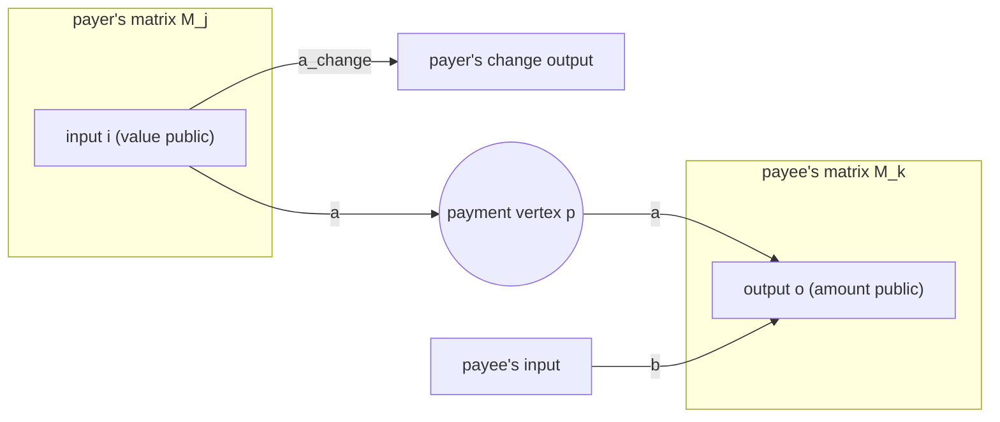
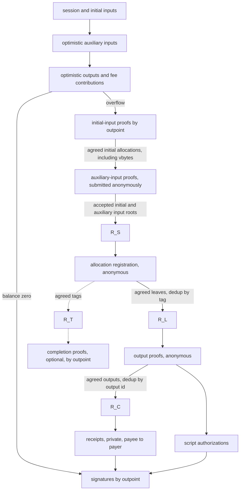
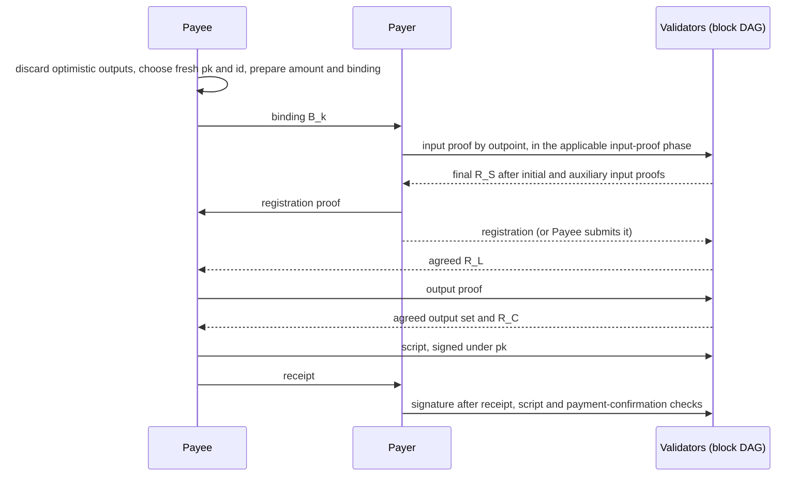

<!-- cspell:words arkworks blindings Bowe Camenisch Campanelli Goodell Holmgaard Kamp dedup Gabizon Groth Hohenberger Kohlweiss Lysyanskaya mathit mathrm mathsf Meyerovich Miers Noether RTAG ungated unlinkable -->

# 🤖 Validity proofs by allocation registration

> 🤖 **Status: selected (2026-10-25).** Allocation registration was chosen
> because the payee doesn't learn the paying input, at the cost of a separate
> registration phase between the input and output proofs; see
> [Compared with other approaches](#compared-with-other-approaches). The
> code is being rewritten from scratch for Fungi. Figures marked *measured*
> come from a proof of concept on a shared machine; parts marked *proposed*
> are not implemented yet. The [open questions](#open-questions) list what is
> not specified yet.

The [overview](overview.md#validity-proofs) explains when validity proofs are
needed: once overspending has been detected, outputs and fee contributions
must prove they are covered by input funds, without revealing how each
participant allocates its funds. This document specifies one way to do that.

🤖 Proofs are needed only in the proven phases, phases 4 to 7 of
[transaction construction](transaction-construction.md#phases). They run only
after overflow in the optimistic outputs phase. The optimistic phases before
them carry no proofs.

🤖 In outline: each input commits to how its value is split, with an input
proof. Each part is then registered anonymously, and each output proves
anonymously that registered parts cover its amount. The
[intuition](#intuition) below explains how, and [Statements](#statements)
specifies each proof.

## Intuition

### Slots, registration and outputs

Three steps carry value from an input to an output:

1. 🤖 **Slots.** Each input splits its value into $D = 9$ slots. Each slot
   specifies an amount and a destination. The input commits to its slots with
   an input proof. Initial inputs prove first, identified by outpoint;
   auxiliary inputs are submitted anonymously with their proofs afterward.
2. **Registration.** Each non-zero slot is turned into a *registered leaf* by
   a registration proof, posted anonymously. The proof shows the slot belongs
   to some admitted input without saying which.
3. **Outputs.** An output proves that up to $K = 2$ registered leaves name it
   as their destination, and that their amounts sum to its amount. It is
   posted anonymously.

A payment is just a slot whose destination is someone else's output. The
payer registers it; the payee claims it.

Payments need no proof about the payment from the payer to the payee, no
recursion and no multi-party computation. The payer only hands the payee its
registration proof early, which is a public object anyway.

Interactive payments and [net settlement](overview.md#net-settlement) are
in scope. The circuits check only the endpoint allocation: slots from
inputs, registered, and claimed by outputs. They have no payment variables.
Payment obligations, including net settlement (a participant without inputs
that receives from A and pays C, or a cycle of payments), are mapped onto
slots, and confirmed with counterparties, by private messages around the
proofs. This document specifies those messages for a direct payment from an
input to an output; the rest is open. $D = 9$ and $K = 2$ bound the endpoint
allocation, not the number of payments.

### Two trees, so payer and payee never share a path

Each proof proves membership in a tree that everyone builds from public,
agreed data:

- the **session tree** over the inputs' slot commitments, used by
  registrations;
- the **registration tree** over registered leaves, used by outputs.

The payer's path, from slot to input, lives only inside its zero-knowledge
registration proof. The payee's path, from leaf to the registration tree's
root, is computed from public data. No input membership path crosses from
payer to payee, so the payee can't learn the paying input, and the payer
can't learn the funded output. What does pass between them is the binding
$B_k$, the registration proof and the receipt.

### A tag per slot limits each input to D registrations

Registration is anonymous, so something has to stop an input registering the
same slot twice. Each registration publishes a tag

$$\mathit{tag}_i = H_\mathsf{RTAG}(\mathit{session}, s, i),\quad 0 \le i \lt D,$$

where $s$ is a secret the input committed to. The tag is deterministic in
$(s, i)$, so a second registration of the same slot repeats the tag and is
dropped. It is pseudorandom without $s$, so it doesn't reveal the input. This
is the idea behind periodic $n$-times anonymous authentication.[^clone-wars]
Here the bound is the number of slots, and the slot's position in the tree
supplies $i$.

### Flood protection

🤖 These bounds apply to the proven phases:

- Auxiliary inputs consume vbyte allocations committed by initial inputs.
- A registration spends one of an admitted input's $D$ slots, so there are at
  most $9 \times 729$ registrations under the input capacity in
  [Parameters](#parameters).
- A proven output must claim at least one registered leaf, and each leaf can
  be claimed by only one output.

🤖 Before overflow, each optimistic output or fee contribution accounts for at
least 1 sat, so the input balance bounds them. These contribution bounds do not
bound all network traffic.

### Destination fixed at commitment

A slot commits to its destination's binding when the input proves
(*destination mode*). So the registered leaf is fully determined by the slot,
and any valid registration of a slot is identical. This is why the payee
must give the payer its binding $B_k$ before the payer's input proof.

The payer hands its registration proof to the payee once $R_S$ is agreed,
and either one can submit it. After the payee has it, the payer can't renege
by withholding its registration. It can only refuse to sign, and then its
input is identified by outpoint. Before that, the payer can still withhold the proof itself
(see [Signing and failures](#signing-and-failures)).

## The flow graph

A transaction moves value from inputs to outputs. Each participant decides
how its own inputs' value is split. Some of that value goes to its own
outputs, and some to payments to other participants.

### As a matrix

Write the flows as a matrix $M$. Rows are sources and columns are sinks.
There are four kinds of vertex:

- **inputs**, whose values are public;
- **outputs**, whose amounts are public;
- **the fee**, a public sink: each input's hidden excess, or fee
  pseudo-outputs;
- **payment vertices**, one per payment. Each is shared by exactly one payer
  and one payee, and is not labelled publicly.

$M$ is the sum of one sparse matrix per participant, $M = \sum_j M_j$. A
participant's $M_j$ has non-zero entries only on edges at its own vertices,
or at payment vertices it shares:

- from its inputs to its own outputs;
- from its inputs to a payment vertex, if it is a payer;
- from a payment vertex to its outputs, if it is a payee.

A payment of $a$ from payer $j$ to payee $k$ through payment vertex $p$
appears in two blocks: the edge into $p$ in $M_j$, and the edge out of $p$
in $M_k$. Both edges stay in the sum. What cancels is the net flow at $p$:
$+a$ in from $M_j$, $-a$ out from $M_k$, so $p$ neither creates nor destroys
value. Contracting $p$ gives an entry of $a$ from the payer's input to the
payee's output.

Contracting every payment vertex leaves a bipartite allocation from inputs
to outputs and the fee. Payments are structure inside its edges, and don't
change its row and column sums. Those sums are public; its entries are not.

### What is observable

- **The boundary is public.** Row sums over input rows are the input values.
  Column sums over output columns are the output amounts. These are exactly
  the public inputs of the proofs below.
- **Each block is private to its participant.** The proofs reveal nothing
  about how a participant splits its inputs beyond the boundary.
- **Each payment entry is known to its payer and payee.** The payer knows its
  input and the amount. The payee knows the amount and its output. The
  proofs reveal neither side to the other.
- **No one is shown the full matrix.** In particular, the proofs don't reveal
  the entry from a payer's input to a payee's output.

These hold under the stated leakage: the public boundary, what counterparties
know of their own payments, and anonymous submission. Amounts, small
anonymity sets and colluding counterparties can still reveal more.

### How the proofs enforce it

The proofs check that no vertex creates value, without anyone assembling
$M$:

| Vertex | Conservation | Checked by |
|---|---|---|
| input | its slot amounts plus a hidden excess equal its public value | input proof |
| payment vertex | the payee can claim at most what the payer registered | registration proof plus output proof, linked by the binding |
| output | its claimed leaves sum to its public amount | output proof |

🤖 Anything registered but not claimed, or committed but not registered, becomes
fee. The proofs establish non-inflation. Counterparty confirmation establishes
that the committed construction satisfies the payment agreement. In the proven
phases, the payer also checks a receipt showing that its allocation was claimed
before signing.

The cost of each proof depends on one participant's block, a fixed small
number of slots, and on the tree depths fixed by the session's capacity.

## Requirements

| Requirement | Status |
|---|---|
| **Privacy.** No association among inputs and outputs beyond the public boundary and what counterparties know of their own payments. | Argued in [Privacy](#privacy), not formalized. Relies on anonymous submission. |
| **Counterparty privacy, both ways.** The payee doesn't learn the paying input; the payer doesn't learn the funded output. | Met by the [two trees](#two-trees-so-payer-and-payee-never-share-a-path) and one blinding $\beta_k$ per source. |
| **No inflation.** Amounts are non-negative, each registered leaf funds at most one output, and outputs sum to at most the inputs. | Met; see [No value is created](#no-value-is-created). |
| 🤖 **Flood protection in the proven phases.** Auxiliary inputs consume initial inputs' vbyte allocations; registrations and outputs consume allocations from admitted inputs. | Registrations are bounded by $D$ per admitted input, and each output must claim a registered leaf. Duplicates count once and equivocation is removed ([Acceptance rules](#acceptance-rules)). vbyte admission is [not in the proof of concept](#not-in-the-proof-of-concept). |
| 🤖 **Session binding.** No statement replays across sessions. | Enforced by the [acceptance rules](#acceptance-rules): validators build each root from statements accepted for that session and verify dependent proofs against the expected root. This is [not in the proof of concept](#not-in-the-proof-of-concept). |
| 🤖 **Honest allocations can't be blocked.** Other participants can't consume or block an honest allocation, apart from the dependency between a payer and its payee. | Tags are per slot, and a leaf is claimable only under its own binding. Proven outputs use [fresh output ids](#fresh-output-ids). |
| **Attributable failure.** A run either completes, or names an input that recovery can exclude. | Met by per-input signatures and the [signing rules](#signing-and-failures). [Completion proofs](#completion-proof-optional) are optional. |
| **Interactive payments and net settlement**, including recipients without inputs, intermediaries and cycles. | In scope. The circuits check any endpoint allocation within $D$ and $K$. The private messages for net settlement are open. |

## Phases and data dependencies

Each public phase ends with agreement on its contribution set (see
[phase closure](optimistic-track.md#phase-closure)). Everyone then
computes the phase's root from the agreed set. Proofs in the next phase use
that root, alongside their own public inputs. No proof depends on another
party's private proof. A phase's boundary is a
[phase transition](optimistic-track.md#phase-transitions) in the
[block DAG](block-dag.md).

🤖 Every public phase is a set to agree on, not a sequence. Proofs within a
phase can be made and posted in any order, and are verified against the
phase's fixed public inputs and roots.

🤖 Initial-input proofs are identified by outpoint and authenticated by their
enrolled online keys. They commit to allocations of funds and vbytes. Their
agreed set supplies the vbyte allocations that auxiliary-input proofs consume.
Once both input-proof sets are fixed, everyone derives the final $R_S$ from the
accepted initial and auxiliary input roots. Output proving then has two stages:
anonymous allocation registration against $R_S$, followed by anonymous output
proofs against the resulting $R_L$.

🤖 The proven phases have the following dependencies, numbered as in
[transaction construction](transaction-construction.md#phases). Payment
confirmation is required before signing on both paths; receipts are additional
checks in the proven phases.

| Phase | Submission | Depends on | Produces |
|---|---|---|---|
| 4. Initial-input proofs | by outpoint | `session`, fixed initial inputs | agreed initial-input allocations, including vbytes |
| 5. Auxiliary-input proofs | anonymous | agreed initial vbyte allocations | accepted auxiliary-input allocations; final $R_S$ |
| 6. Allocation registration | anonymous | `session`, $R_S$ | registered-leaf root $R_L$; tag root $R_T$ if needed |
| completion proofs, optional | by outpoint | input root, $R_T$ | evidence that an input's non-zero slots were registered |
| 7. Output proofs | anonymous | `session`, $R_L$ | proven output set, claim root $R_C$ |
| script authorization | anonymous | output id, output key, script | authorized final outputs |
| 8. Signatures | by outpoint | final transaction, payment confirmations and applicable receipts | transaction |

### Private messages between payer and payee

🤖 In the proven phases, each direct payment adds the following three private
proof messages. They are exchanged only when proving is needed, within the
windows shown below. The ordinary payment-confirmation exchange remains
required as well.

| Message | After | Before |
|---|---|---|
| payee → payer: binding $B_k$ | `session` known; output amount and id chosen | the payer's input proof |
| payer → payee: registration proof | $R_S$ agreed | registrations close |
| payee → payer: receipt | $R_C$ agreed | the payer signs |

What this means for being online:

- 🤖 Payer and payee must be available for payment confirmation after output
  finalization and before input signing, and, if proving becomes necessary,
  for these proof messages.
- 🤖 The payee chooses [fresh output ids](#fresh-output-ids), and supplies the
  binding before the applicable input proof. Script authorization follows the
  proven output set.
- Third parties never see a pair's private messages. But a party waiting on
  one may delay its part in a public agreement, so third parties can wait on
  them indirectly. A stalled agreement is resolved by
  [recovery](recovery-track.md#fault-tolerance-via-branched-execution), not by the proofs.

## Parameters

| Symbol | Value | Meaning |
|---|---|---|
| curve | BN254 | proof system field and pairing |
| proof system | TurboPlonk, KZG, jellyfish | universal setup |
| $H$ | Poseidon, width 4, rate 3, $\alpha = 5$, 8 full and 56 partial rounds | all in-circuit hashing |
| arity | 3 | every Merkle tree |
| $D$ | 9 | slots per input (2 tree levels) |
| inputs | at most 729 | session tree, 6 levels |
| registrations | at most 6,561 | registration tree, 8 levels |
| $K$ | 2 | registered leaves per output |
| amount bits | 51 | $2^{51} > $ 21 million BTC in satoshis |
| excess bits | 32 | an input's hidden fee share |

*Placeholder constants:* the proof of concept generates Poseidon constants
with arkworks' Grain generator. They are not the reference constants.
Production must load the reference constants.

## Hashes and objects

$H_\mathsf{dom}(x_1, \dots, x_m)$ is the Poseidon sponge with the capacity
element set to the domain constant $\mathsf{dom}$, absorbing three elements
per permutation. Each domain has a fixed input length. Tree nodes are one
permutation of $(\mathsf{NODE}, c_1, c_2, c_3)$.

In the proof of concept:

- The state is $(\mathsf{dom}, 0, 0, 0)$. Each block of up to three inputs
  is added to elements 1–3, then the state is permuted. The hash is element 1
  of the final state, and so is a tree node.
- Domain constants and input lengths:

  | Domain | Constant | Inputs |
  |---|---|---|
  | ALLOC | 7 | 3 |
  | OUT | 8 | 3 |
  | SLOT | 11 | 3 |
  | RTAG | 12 | 3 |
  | CLAIM | 13 | 3 |
  | SID | 14 | 1 |
  | NODE | $2^{32}$ | 3 children |

- Amounts and slot indices enter as field elements of their integer value.
- The output id is the first 31 bytes of the SHA-256 digest read as a
  little-endian integer. SHA-256 is taken over the 32-byte x-only
  serialization of $\mathit{pk}$.
- In the script authorization message, `session` and the id are 32-byte
  little-endian field encodings, followed by the raw script.
- Padding for trees smaller than their capacity is not defined yet. The
  jellyfish tests use random siblings. The Groth16 reference pads with a
  hash of a separate EMPTY domain, but under a different Poseidon instance.
- 🤖 `session` is the instance id $\mathit{sid}$ of the
  [optimistic track](optimistic-track.md#hashes-and-identifiers), a hash of the
  [coalition formation](overview.md#coalition-formation) proposal, as a
  field element. The mapping is not fixed yet; the first 31 bytes as a
  little-endian integer, as for the output id, would do (*proposed*). The
  proof of concept takes `session` as a field element directly.

| Object | Definition | Known to | Public |
|---|---|---|---|
| $s$ | random, fresh per input and per attempt | the input's owner | no |
| $a_i$, $B_i$ | slot $i$'s amount and destination binding | the input's owner; the payee for its own slot | no |
| slot | $\mathit{slot}_i = H_\mathsf{SLOT}(a_i, B_i, s)$ | the input's owner | no |
| input root | 2-level tree over $\mathit{slot}_0 \dots \mathit{slot}_8$ | everyone | yes |
| $R_S$ | session root: 6-level tree over the agreed input roots, in the agreed input order | everyone | yes |
| tag | $\mathit{tag}_i = H_\mathsf{RTAG}(\mathit{session}, s, i)$ | everyone, after registration | yes |
| leaf | $\mathit{leaf}_i = H_\mathsf{ALLOC}(a_i, B_i, \mathit{tag}_i)$ | everyone, after registration | yes |
| $R_L$ | registration root: 8-level tree over the agreed leaves, sorted by leaf hash (*proposed*) | everyone | yes |
| $R_T$ | tag root: 8-level tree over the agreed registrations' tags; only for completion proofs | everyone | yes |
| $\mathit{pk}$ | [fresh](#fresh-output-ids) key per proven output; not a spending key | the payee | after proven outputs |
| output id | $\mathrm{SHA256}(\mathit{pk})$, first 31 bytes | the payee until the output-proof phase; then everyone | yes, when posted |
| binding | $B_k = H_\mathsf{OUT}(\mathit{amount}, \mathit{id}, \beta_k)$, one random blinding $\beta_k$ per source $k$ | the payee; payer $k$ sees only $B_k$ | no |
| claim commitment | $\mathit{cc} = H_\mathsf{CLAIM}(u_1 \mathit{leaf}_1, u_2 \mathit{leaf}_2, r)$ | everyone | yes |
| $R_C$ | claim root: 8-level tree over the agreed outputs' claim commitments | everyone | yes |

The output id follows the
[concurrent PSBT](psbt-concurrent.md#unique-identifiers-for-outputs)
requirement that each output has a unique identifier. A scriptPubKey can't
serve, because it may not be stable until after the output set is. Taking the
id as the hash of a fresh key lets the payee later authorize the output's
script.

🤖 **Fresh output ids.** Optimistic outputs are discarded when the proven
phases start, and their ids are not reused. For each proven output, the payee
chooses a fresh key $\mathit{pk}$, distinct from its optimistic outputs and
earlier attempts, so the output id is unguessable. The payee keeps the id
private until the output-proof phase, after the input allocations and
registrations are fixed. Until then, payers see only their bindings $B_k$.

🤖 A slot's binding $B_i$ is the binding $B_k$ that the payee gave for that
source: $i$ indexes the payer's slots, and $k$ the output's sources.

🤖 The payee keeps each blinding $\beta_k$ private. Revealing it to payer $k$
would let that payer test its binding $B_k$ against the public output
amounts and ids.

🤖 Each source uses an independently sampled blinding. With a shared binding,
a payer could combine its known allocation amount with a candidate public
output amount to guess the other source's amount, then test that guess
against the public registration leaves and tags. Independent bindings
prevent this test because the payer does not know the other source's
binding.

🤖 The binding doesn't repeat `session`. An output proof is verified against the
registration root of its own session, and that root is built only from
registrations verified in that session, so a leaf is claimable only where it
was registered. See [Acceptance rules](#acceptance-rules).

## Statements

All circuits are TurboPlonk over BN254 with the parameters above.

### Input proof

*Purpose:* conservation at an input, and commitment to its slots.

🤖 The statement below covers the allocation of value. Initial-input proofs
also commit to vbyte allocations, which auxiliary-input proofs consume; that
part is [not in the proof of concept](#not-in-the-proof-of-concept).
Input-proof messages identify their input by outpoint and bind the statement to
the session. Both initial and auxiliary input-proof messages are authenticated
by the input's own online key, enrolled by its BIP-322 ownership proof.
Auxiliary-input messages are still submitted anonymously.

- **Public:** `session`, value (the input's amount), input root.
- **Witness:** $s$; for each slot, $a_i$ and $B_i$; the excess $e$.
- **Constraints:**
  - $a_i \lt 2^{51}$ for every slot, and $e \lt 2^{32}$;
  - $\sum_i a_i + e = \mathit{value}$;
  - the input root is the tree over $\mathit{slot}_i = H_\mathsf{SLOT}(a_i, B_i, s)$.
- **Cost (*measured*):** 1,855 gates, domain $2^{11}$, 0.31 s to prove.

The range checks stop a hidden slot of $p - x$ cancelling an oversized
slot. Nine 51-bit slots and a 32-bit excess can't wrap the field. The excess
is this input's share of the fee. Fee pseudo-outputs, which spend a slot like
an output, are an alternative. A zero slot needs no destination; any $B_i$
will do. A self-transfer is a slot whose binding is the participant's own
output.

### Registration proof

*Purpose:* turn a committed slot into an anonymous registered leaf, at most
once.

- **Public:** `session`, $R_S$, tag, leaf.
- **Witness:** $s$, $a_i$, $B_i$, the 8-level path from $\mathit{slot}_i$ to
  $R_S$.
- **Constraints:**
  - the path proves $\mathit{slot}_i$ is in $R_S$. The two inner levels expose
    the position as base-3 digits, which give $i$. The outer six hide which
    input it is;
  - $\mathit{tag} = H_\mathsf{RTAG}(\mathit{session}, s, i)$;
  - $\mathit{leaf} = H_\mathsf{ALLOC}(a_i, B_i, \mathit{tag})$, with the same
    $a_i$ and $B_i$ variables as the slot.
- **Cost (*measured*):** 1,017 gates, domain $2^{10}$, 0.16 s to prove.

No range check is needed, because $a_i$ is the slot's range-checked amount.

### Output proof

*Purpose:* conservation at an output.

- **Public:** `session`, $R_L$, amount, output id, cc.
- **Witness:** for $k \in \{1, 2\}$, $\beta_k$, $a_k$, $\mathit{tag}_k$
  and a path; $u_2$ (second source used); a filler value; $r$. $u_1$ is the
  constant 1. An unused source's path starts from the filler instead of its
  leaf, and is not checked against $R_L$, but the prover must still supply
  one.
- **Constraints:**
  - $B_k = H_\mathsf{OUT}(\mathit{amount}, \mathit{id}, \beta_k)$ for each source;
  - for each used source, $H_\mathsf{ALLOC}(a_k, B_k, \mathit{tag}_k)$ is in $R_L$;
  - $u_1 = 1$, so every output claims at least one leaf. Without this, an
    output with no sources and amount 0 would verify, and outputs would be
    ungated;
  - 🤖 $u_2 \in \{0, 1\}$, so the second source is used whole or not at all.
    Without this, $u_2 a_2$ could be any field element;
  - if both sources are used, their leaves differ;
  - $\sum_k u_k a_k = \mathit{amount}$;
  - $\mathit{cc} = H_\mathsf{CLAIM}(u_1 \mathit{leaf}_1, u_2 \mathit{leaf}_2, r)$.
    An unused source enters as 0, so a receipt can open only on a leaf the
    output actually spent.
- **Cost (*measured*):** 1,931 gates, domain $2^{11}$, 0.32 s to prove.

$K = 2$ covers one payment plus the payee's own slot. A payee paid by
several payers uses one output per payment, or a larger $K$. Larger $K$ is not
measured. $K = 4$ probably moves to domain $2^{12}$, about 0.6 s
(*estimate*).

### Receipt (private)

*Purpose:* show the payer its payment was claimed, without saying which
output claimed it.

🤖 A receipt is distinct from payment confirmation. It proves that the payment
allocation was claimed in the proven state. Confirmation tells the payer that
the committed construction satisfies the payment agreement, as the
[concurrent PSBT specification](psbt-concurrent.md#confirmation-of-successful-payment-prior-to-signing)
defines. The proven phases require both checks before signing.

- **Public:** $R_C$, the payer's leaf.
- **Witness:** the output's claim commitment, its path to $R_C$, the other
  claimed leaf, $r$, and which side the payer's leaf is on.
- **Constraints:** the commitment is in $R_C$ and opens to the payer's leaf on
  one side.
- **Cost (*measured*):** 827 gates for an 8-level $R_C$, domain $2^{10}$,
  0.17 s to prove. A 6-level $R_C$ (729 outputs) is 645 gates (*counted*).
  It is verified only by the payer.

### Completion proof (optional)

*Purpose:* show that every non-zero slot of an input was registered. Where
the session requires it, an input that doesn't give one is identified by
outpoint as incomplete or unresponsive. That doesn't show who failed: the payer
may not have handed over its registration proof, or the payee may have received it
and not posted it.

No other rule needs it: an omitted registration
only removes value from what can be claimed, and that value goes to the fee.
It can't inflate funds or consume another participant's allocation. A
counterparty that doesn't complete can make its partner withhold a
signature, which recovery already handles. The completion proof only adds
attribution within the pair: without it, a payer that reneges can make its
payee appear faulty.

🤖 The measured completion proof takes about 2.3 s on one
thread, compared with 0.16–0.33 s for the other proof types.

- **Public:** `session`, input root, $R_T$.
- **Constraints:** for each slot, $a_i = 0$, or
  $\mathit{tag}_i = H_\mathsf{RTAG}(\mathit{session}, s, i)$ is in $R_T$.
- **Cost:** 8,578 gates, domain $2^{14}$ (*counted*). 2.3 s to prove,
  measured at 8,569 gates without destination bindings, in the same domain.

A variant publishes an input identifier $H_\mathsf{SID}(s)$ in the input
proof and binds the completion proof to it, with the same $R_T$. That fits $2^{13}$
(1.1 s). But it loses the zero-slot exemption: every input then registers
all nine slots, with dummies.

The root-bound proof could instead prove its leaves are in $R_L$, with no
$R_T$. That costs about 810 more gates, still in $2^{14}$ (*estimate*). The
$H_\mathsf{SID}$ variant can't, because it has no amounts or bindings.

## Acceptance rules

Every validator applies the same deterministic rules to the agreed sets:

- **Verification.** Each proof verifies against its circuit's fixed
  verifying key and the agreed root it names. A phase's proofs can be checked
  in one `batch_verify`, which accepts a mix of circuits.
- **Duplicates and equivocation.** These are validator rules, not part of
  the proofs; the proofs make them possible by exposing the tag and the
  output id as public keys. Proofs of the same statement are duplicates, even
  if their bytes differ, and are counted once. Different valid statements
  under one key are equivocation, and only identify which output every
  validator removes. An agreed set has no order, so no rule may depend on
  which arrived first. The
  proof of concept keeps the first in list order instead.
- 🤖 **Inputs:** keyed by outpoint. An input proof is posted by its outpoint
  and authenticated by the input's online key, bound to `session`; two
  different input proofs for one outpoint are per-input equivocation, as
  defined in the [optimistic track](optimistic-track.md#per-input-messages), and
  remove the input.
- **Registrations:** keyed by tag. The slot fixes the leaf, so every
  registration of a slot has the same statement, and equivocation can't
  happen.
- 🤖 **Outputs:** keyed by output id. Two statements for one id can differ in
  the claim commitment or in which leaves they spend. Conflicting statements
  remove that output, and its leaves' value goes to the fee. Because proven
  output ids are [fresh](#fresh-output-ids), other participants cannot prepare
  their own allocation to an honest output id; see
  [No value is created](#no-value-is-created).
- **Trees:** each in an order that doesn't depend on arrival:
  - $R_S$ over input roots in the agreed input order;
  - $R_L$ over agreed leaves sorted by leaf hash (*proposed*; the proof of
    concept uses arrival order);
  - $R_C$ over exactly the kept outputs' claim commitments, sorted by output
    id (*proposed*);
  - $R_T$, if completion proofs are used, over the kept registrations' tags.

  🤖 Each tree is built only from statements that verified with this session's
  `session` as a public input, and each proof is verified against its own
  session's root. The bindings don't carry `session`; this rule is what stops a
  leaf being claimed in another session. Validators must enforce this
  association when constructing roots and accepting dependent proofs.
- **Script authorization.** After the output set is agreed, each output's
  owner posts $(\mathit{pk}, \mathit{script}, \sigma)$, with $\mathit{pk}$ an
  x-only secp256k1 key. It is accepted if the first 31 bytes of
  $\mathrm{SHA256}(\mathit{pk})$ equal the output id, and $\sigma$ is a valid
  BIP 340 signature under $\mathit{pk}$ over
  $\mathrm{SHA256}(\mathit{session} \| \mathit{id} \| \mathit{script})$.
  Conflicting authorizations for one id are equivocation, and remove the
  output. This matters only for consistency, not for incentives. Removal is
  simpler than any other way to break the tie. The proof
  of concept checks the output proof, key hash and signature together, as one
  posted output. The spec separates them because the script may only be
  stable after the output set is.
- **Balance.** The fee is $\sum \mathit{value} - \sum \mathit{amount}$. It is
  public and must meet the session's terms.

## Signing and failures

🤖 These signing rules apply after the proven phases. Every sender also
obtains the payment confirmations required by the
[concurrent PSBT specification](psbt-concurrent.md#confirmation-of-successful-payment-prior-to-signing).

- **A payer signs only after verifying a receipt** for each of its payments,
  and only the complete transaction with every output's script authorized.
  Otherwise it risks its funds going to the fee. A receipt shows the payment
  was claimed in $R_C$; it doesn't show the script or the settlement.
- **A payee signs its own inputs only if its output is in the transaction**
  with the agreed amount and script.

If either fails, the other $n - 2$ participants must be able to make
progress without them:

- 🤖 **A refusal is attributable.** Signatures are identified by outpoint, so
  an input that doesn't sign is identified by that outpoint. Blame may fall on
  the pair, payer or payee or both, because they trust each other for liveness. They don't trust third parties
  for it.
- 🤖 **Retry without the excluded outpoint.** The retry is a new recovery
  proposal, so it has a new `session` and keeps the exclusions of earlier
  attempts. It follows the same phase order, including the optimistic phases;
  any subsequent proving uses fresh secrets, amounts, keys and output ids.
  The measured value-allocation proof work is about 1.1 s per participant on
  one thread: an input, two registrations, an output and a receipt (*derived*).
  This excludes vbyte admission.
- **Not in place.** Continuing the same attempt without the excluded input
  would show which outputs drop out. Those are exactly that input's payees,
  so the link would leak for whichever member of the pair was honest.

What each failure costs:

| Failure | Who is identified by outpoint | Who loses |
|---|---|---|
| payer refuses to sign after a valid receipt | the payer's input | the payee's payment, until the retry |
| payee never claims | the payer's input (no receipt, so it won't sign) | the pair |
| payer never hands over its registration proof | the payer's input, if it follows the signing rule (no receipt); the payee's inputs, if it has any and refuses to sign; with completion proofs required, an input that can't give one, which is the same if the payee received the proof and didn't post it | the pair |
| anyone posts an invalid proof | nobody needs to be: it is rejected | nobody |

🤖 A payee that never claims can get each payer who agreed to pay it identified
by outpoint once.
That stays within the trust the pair placed in each other. A missing
completion proof shows that an input didn't meet its obligations, under the
session's rules. It doesn't show whether that was malice or failure.

## Security sketch

### No value is created

1. **Input:** the hidden slots plus the excess equal the public value, and
   none can be negative.
2. **Registration:** each slot registers at most once, because its tag is
   unique. A leaf carries the slot's own amount and binding.
3. **One output:** its used leaves are distinct, and they sum to its amount.
4. **Across outputs:** a leaf names one binding, which contains one output
   id. Outputs are deduplicated by output id, so no leaf is claimed twice.

So $\sum \mathit{amount} \le \sum \mathit{registered} \le \sum \mathit{value}$.
🤖 The rest is fee. This proves non-inflation. Payment satisfaction is checked
by counterparty confirmation, with an additional receipt check in the proven
phases, before signing. Failures are attributed as in
[Signing and failures](#signing-and-failures).

🤖 Non-inflation uses deduplication by output id and the destination binding.
Liveness additionally relies on [fresh output ids](#fresh-output-ids). An
attacker that learns an id when it is posted cannot change its committed
allocations to fund a conflicting statement under that id. This argument does
not cover ids disclosed before those commitments are fixed.

🤖 The PoC also checks the output-id key and a signature over the session, id
and script together with the output proof. That signature authorizes the script;
it does not bind the amount, allocation sources or claim commitment. The
liveness argument above relies on the ordering and secrecy of the fresh id,
rather than treating that signature as authentication of the whole funding
statement. Script authorization may remain separate from output proving.

### Privacy

- **The payee doesn't learn the paying input.** The payer's path is a
  zero-knowledge witness. Tags are pseudorandom without $s$.
- **The payer doesn't learn the funded output.** It knows only $B_k$. The
  output id becomes public when the output is posted, but the blinding never
  leaves the payee, so the payer can't match $B_k$ to it. Each source has its
  own blinding, so the payer can't test the other sources' leaves either. The
  receipt hides which commitment it opens.
- **Registrations are unlinkable to inputs.** This assumes anonymous
  submission, and tree orders that don't depend on arrival.
  Peers submit over a sender-anonymous transport. If the transport doesn't
  provide message unlinkability, each connection carries only one message.
  The sender checks through gossip that its message reached the peers.
- **Payments per output are hidden.** Every output proof has $K$ source
  positions, whether the second is used is a witness, and the claim
  commitment hides which leaves it spent.
- **The payment count depends on the session's terms.** The number of
  registrations is public. If the terms fix the number of registrations per
  input, with zero slots registered as dummies to fill it, the count reveals
  nothing about payments. The numbers of inputs and outputs are inherently
  public.

  The fixed number should make enough payments plausible that actual
  payments could change the analysis significantly. A handful of plausible
  payments in a large transaction is a strong constraint, suggesting the
  sub-transaction model may apply. No proof enforces the number; an input
  that registers fewer only weakens it.
- **Proof blinding.** jellyfish randomizes the wire, permutation and
  quotient polynomials. The privacy argument assumes zero knowledge for the
  proof system and transcript used here.

### Assumptions

- KZG and TurboPlonk on BN254 in the algebraic group model, with a ceremony
  that had at least one honest contributor.
- BN254's security is about 100 bits, not 128.
- Poseidon is collision resistant, and pseudorandom when keyed by $s$ (tags).
- $B_k$ and the claim commitment hide their contents, given their random
  blindings $\beta_k$ and $r$.
- Anonymous submission of registrations and outputs.

🤖 The non-inflation argument relies on proof soundness and the binding
properties of the hashes. If either fails, the allocation proofs no longer
establish funding coverage. A forged conflicting statement under an honest
output id can also cause that output to be removed, disrupting completion
without identifying the forger. Failure of anonymous submission instead
exposes links between messages and their senders.

🤖 The setup must produce an SRS whose trapdoor is unknown to every participant,
including the aggregator. An existing compatible ceremony can supply this
SRS; initiating a session does not require generating a new setup.

Attempting a transaction leaks information that no proof can hide. Fresh
amounts, keys and output ids on each attempt limit what recurs across
attempts.

## Implementation and performance {#performance}

1. **Rust implementation.** The proofs use the
   [jellyfish](https://github.com/EspressoSystems/jellyfish) implementation
   of TurboPlonk with KZG commitments.
2. **Universal setup.** No per-circuit ceremony. Any BN254 powers-of-tau
   ceremony of degree at least 2,050 works for the input, registration,
   output and receipt proofs. The optional completion proof needs 16,386
   (8,194 for its variant). For example
   [Perpetual Powers of Tau](https://github.com/privacy-scaling-explorations/perpetualpowersoftau)
   or [Aztec Ignition](https://github.com/AztecProtocol/ignition-verification).

*Measured* with jellyfish on BN254, under load 3–6, medians of 3:

| Proof | Gates | Domain | Prove, 1 / 10 threads | Verify, single | Batched, per proof |
|---|---|---|---|---|---|
| input | 1,855 | $2^{11}$ | 309 / 66 ms | 1.22 ms | 50 µs |
| registration | 1,017 | $2^{10}$ | 164 / 37 ms | 1.26 ms | 51 µs |
| output, with claim commitment | 1,931 | $2^{11}$ | 324 / 63 ms | 1.32 ms | 56 µs |
| receipt | 827 | $2^{10}$ | 165 / 36 ms | 1.24 ms | 43 µs |
| completion (optional) | 8,578 | $2^{14}$ | 2,261 / 440 ms[^value-mode] | 1.22 ms | 42 µs |

Every proof is 769 bytes, and each verifying key is 1,146 bytes.

A session with 500 inputs, 1,000 registrations and 500 outputs has 2,000
proofs, 1.79 MB including public inputs. It verifies in one batch in 90 ms on
one thread, or 21 ms on ten. Each participant proves in about 1 s on one
thread: one input, two registrations and one output. 🤖 500 inputs is an
example below the 729-input capacity.

### 🤖 Not in the proof of concept {#not-in-the-proof-of-concept}

- **vbyte admission.** The proof of concept treats initial and auxiliary
  inputs as one input type. Initial-input vbyte allocations, and their
  consumption by auxiliary inputs, are protocol requirements it doesn't
  implement. Its measurements don't include their cost.
- **Per-session roots.** It checks single proofs and doesn't build the trees,
  so it doesn't implement the [acceptance rule](#acceptance-rules) that builds
  each root from statements accepted for that session.

### Compared with other approaches

🤖 jellyfish was chosen over these alternatives:

- **Groth16.**[^groth16] It needs a trusted setup for each circuit, which is problematic for privacy. The setup's second phase is specific to the circuit, and its participants contribute one after another,[^bgm] which doesn't work well here. A universal setup reuses an existing ceremony instead.
- **Sigma protocols and STARKs.** They need no trusted setup, but their verifier complexity is too high.
- **Curve Forests.**[^curve-forests] Its verifier cost is logarithmic in the set size, but for our range of set sizes its overhead dominates over a Triptych sigma protocol,[^triptych] whose verifier cost is linear.
- **Anonymous credentials.** With roughly 500 validators, credential issuance and its proof work may cost each validator too much, depending on the scheme, the threshold and the number of contributions. This needs measuring.

🤖 Payment negotiation state stays with the two counterparties. Their payment confirmations bind to the proof messages in the DAG; the negotiation transcript does not become shared validator state.

🤖 The table below also compares two ways of proving payments directly,
without a registration phase:

- **Split proving.** The payer proves its own allocation with a
  commit-carrying Groth16 proof, which the payee re-randomizes for its output
  proof.
- **Recursion.** The payee's output proof verifies the payer's proof, one
  level deep: inner proofs on BLS12-377, the outer proof on BW6-761.

For an output funded by two payers:

| Approach | Setup | Bytes | Payee proving |
|---|---|---|---|
| this one | universal | 2,723 (two registrations and one output, with public inputs) | 0.32 s |
| split proving, Groth16 | per circuit | 1,176, with public inputs | not measured |
| recursion, Groth16 two-chain | per circuit | 484 | 6.0 s |

## Open questions

- Sorting the registration tree.
- The private messages for net settlement: payments through participants
  without inputs, and cycles, mapped to slots bound to final outputs.
- Tree padding.
- Measured cost of $K > 2$.
- 🤖 Whether registrations can be posted anonymously, or in the same phase as
  the input proofs, under an auxiliary rate-limiting mechanism. That would
  merge the registration phase into the input phase.
- Whether to keep completion proofs at all, as an optional extension.
- Whether the concurrent PSBT specification already authenticates a late
  script for an output id, so script authorization can reuse it.
- Reference Poseidon constants, and the choice of ceremony.
- The number of registrations per input to fix in the session's terms, and
  its cost: 0.16 s and 769 B per dummy registration.

[^value-mode]: Measured at 8,569 gates, without destination bindings.

[^groth16]: J. Groth, [*On the Size of Pairing-based Non-interactive Arguments*](https://eprint.iacr.org/2016/260) (2016).

[^curve-forests]: M. Campanelli, M. Hall-Andersen and S. H. Kamp, [*Curve Forests: Transparent Zero-Knowledge Set Membership with Batching and Strong Security*](https://eprint.iacr.org/2024/1647) (2024).

[^triptych]: S. Noether and B. Goodell, [*Triptych: Logarithmic-sized Linkable Ring Signatures with Applications*](https://eprint.iacr.org/2020/018) (2020).

[^bgm]: S. Bowe, A. Gabizon and I. Miers, [*Scalable Multi-party Computation for zk-SNARK Parameters in the Random Beacon Model*](https://eprint.iacr.org/2017/1050) (2017).

[^clone-wars]: J. Camenisch, S. Hohenberger, M. Kohlweiss, A. Lysyanskaya and M. Meyerovich, [*How to Win the Clone Wars: Efficient Periodic n-Times Anonymous Authentication*](https://eprint.iacr.org/2006/454) (2006).
