# Concurrent PSBT Construction

## Abstract

This document extends BIP 370 with new PSBT fields and rules for constructing transactions concurrently, so participants no longer need to agree on the order in which inputs and outputs are added. Inputs and outputs are treated as unordered sets instead of ordered lists, and a strict *Combiner* restricts the BIP 174 *Combiner* by failing on conflicting values while extending it to non-identical PSBTs that may overlap. An ordering procedure then produces a consistent PSBT that can be handled by the normal BIP 174 roles.

## Motivation

In a distributed system, it is easier to deliver messages without guaranteeing the order of delivery is consistent across nodes. To build a transaction, participants need to agree on which inputs it spends, which outputs it creates, and how those inputs and outputs are ordered. They don't need to agree on the order in which those inputs and outputs were added.

## Background

### BIP 174 Combiner

BIP 174 defines *Combiner* functionality. Its purpose is to integrate information added by either the *Updater* or *Signer* roles to divergent copies of a PSBT. According to the specification, the Combiner is intended for PSBTs whose underlying unsigned transactions are identical.

### BIP 370 Constructor

BIP 370 introduced a *Constructor* role, which allows signaling that the inputs or outputs of a PSBT are modifiable. Arbitrary mutation of the inputs and outputs is then allowed, but this assumes such state updates are done sequentially. The Combiner role is mostly unchanged in BIP 370, and is restricted to only allow combining fields of PSBTs which spend and create the same outputs in the same order. This facilitates aggregating signatures from multiple parties in any order, but has limited usefulness during the construction of the PSBT.

### `joinpsbts`

Bitcoin Core implements a [`joinpsbts`](https://bitcoincore.org/en/doc/30.0.0/rpc/rawtransactions/joinpsbts/) RPC command that allows merging PSBTs, so long as their spent output sets are disjoint.

`joinpsbts` is not idempotent with respect to inputs (writing it as $+$, idempotence would mean that $A + A = A$). Attempting to join a PSBT more than once fails closed: if $B$ contains an input, and $A + B$ is defined, then $(A + B) + B$ will fail, because a transaction cannot spend the same coin twice.

`joinpsbts` is also not idempotent with respect to the outputs, potentially leading to overspending: if $B$ contains just an output, then $B + B$ will contain two copies of that output.

`joinpsbts` is not strictly associative or commutative, because it shuffles. $(A + B) + C$ can serialize differently from $A + (B + C)$, and $A + B$ from $B + A$. The same coins are spent and the same payments created either way. However, in a concurrent setting, replicas will have diverging copies of the PSBT.

## Specification

The new field types for distributed PSBT construction are as follows:

### New global types

> [!NOTE]
> Field values are currently TBD, and as implemented, the name (e.g. `PSBT_GLOBAL_TX_UNORDERED`) is used as the proprietary field type.

| Name | `keytype` | `keydata` | `keydata` Description | `valuedata` | `valuedata` Description |
| --- | --- | --- | --- | --- | --- |
| Transaction Unordered Flag | `PSBT_GLOBAL_TX_UNORDERED = TBD` | None | No key data | `<8-bit uint>` | If present, MUST be set to `0x03` to indicate inputs and outputs are unordered. |
| Sort Seed | `PSBT_GLOBAL_SORT_SEED = TBD` | None | No key data | `<bytes globalseed>` | Random seed used to derive deterministic sort keys when explicit per-map sort keys are absent. |
| Deterministic Sort Flag | `PSBT_GLOBAL_SORT_KEY_DERIVATION = TBD` | None | No key data | `<8-bit uint>` | A value of `0x01` indicates all sort keys MUST be deterministically derived. A value of `0x00` indicates only explicit sort keys are allowed and `PSBT_GLOBAL_SORT_SEED` is disallowed. If absent, missing explicit sort keys are derived. At the time of sorting either every input and output must have an explicit sort key, or `PSBT_GLOBAL_SORT_SEED` MUST be set and sort key derivation allowed or required. |

### New per-input types

| Name | `keytype` | `keydata` | `keydata` Description | `valuedata` | `valuedata` Description |
| --- | --- | --- | --- | --- | --- |
| Input Sort Key | `PSBT_IN_SORT_KEY = TBD` | None | No key data | `<bytes sort key>` | Arbitrary lexicographically comparable value used to order inputs. |

### New per-output types

| Name | `keytype` | `keydata` | `keydata` Description | `valuedata` | `valuedata` Description |
| --- | --- | --- | --- | --- | --- |
| Output Unique ID | `PSBT_OUT_UNIQUE_ID = TBD` | None | No key data | `<bytes unique id>` | Universally unique identifier for output map identity under unordered output semantics. |
| Output Sort Key | `PSBT_OUT_SORT_KEY = TBD` | None | No key data | `<bytes sort key>` | Arbitrary lexicographically comparable value used to order outputs. |

Example collaborative protocol (*N* wallets). Creator and Constructor set `PSBT_GLOBAL_SORT_SEED` and share that PSBT with every wallet. Each wallet *i* runs the same pipeline below in parallel. Combiner once all wallets have signed.

```mermaid
flowchart LR
    subgraph init ["Creator / Constructor"]
        EMPTY[empty PSBT]
        SEED[PSBT with PSBT_GLOBAL_SORT_SEED set]
        EMPTY -->|set PSBT_GLOBAL_SORT_SEED| SEED
    end
    SEED -->|Distribute to wallets| Pop

    subgraph Wi ["Wallet i (i = 1..N)"]
        direction LR
        Pop[PSBT populated with Wallet i's inputs and outputs]
        Pop -->|Send and join received PSBTs from other wallets| Join[PSBT populated with all wallets' inputs and outputs]
        Join -->|sort, then clear PSBT_GLOBAL_TX_UNORDERED field| Clear[Sorted inputs and outputs]
        subgraph us ["Updater / Signer"]
            SIG[Wallet i's signed PSBT]
        end
        Clear --> SIG
    end

    subgraph combine ["Combiner"]
        COMB[N signed PSBTs]
    end

    subgraph finish ["Finalizer / Extractor"]
        SIGNED[signed tx]
    end

    SIG --> COMB
    COMB --> SIGNED
```

### Strict Combiner

BIP 174 lets a [Combiner](https://github.com/bitcoin/bips/blob/master/bip-0174.mediawiki#user-content-Combiner) resolve a key that has two different values by picking either one. That is safe when every PSBT shares the same unsigned transaction, because the worst outcome is an invalid signature. Once inputs and outputs can differ between copies, picking one value can change what the transaction spends or pays, and the result depends on the order in which copies were combined.

A strict Combiner therefore MUST fail when the same key has conflicting values. With this rule, the transaction effects of combining a set of PSBTs do not depend on the order or grouping of the combinations, or on whether a PSBT is combined more than once. The following sections define exceptions that keep these properties.

#### Combining PSBTs

Reordering a transaction's inputs or outputs does not change which coins it spends or which payments it creates. Treating them as unordered sets is what lets us combine PSBTs that are not identical.

To represent this, we define a global field `PSBT_GLOBAL_TX_UNORDERED`, indicating whether the order of inputs and outputs should be ignored. When present, it MUST be set to `0x03`, indicating the transaction is unordered.[^tx-unordered]

When `PSBT_GLOBAL_TX_UNORDERED` is set, the input or output maps are not distinguished by their index, but instead by a unique identifier defined for each input or output.

Inputs or outputs with identical unique IDs are merged by combining their key-value pairs with the stricter, idempotent combination [defined above](#strict-combiner). After merging the inputs and outputs that appear in both PSBTs, the strict Combiner additionally keeps the ones that appear in only one of them.

Distinct identifiers are only allowed if the corresponding BIP 370 `PSBT_GLOBAL_TX_MODIFIABLE` flag is set, because such combinations represent additions of inputs or outputs. If this is not the case but a distinct input or output is present, then combining MUST fail.[^tx-modifiable]

Unordered PSBTs MUST be shuffled prior to reserialization.[^shuffle] If all inputs and outputs have [sort keys](#ordering-inputs-and-outputs), the key-based ordering MAY be used instead of shuffling.

#### Unique identifiers for inputs

Inputs are identified by their outpoint, i.e. the tuple of their `PSBT_IN_PREVIOUS_TXID` and `PSBT_IN_OUTPUT_INDEX`, both of which MUST be set according to BIP 370.

#### Unique identifiers for outputs

Outputs are identified by a new `PSBT_OUT_UNIQUE_ID` field, which MUST be universally unique (e.g. 16 bytes of randomness).

This ensures that repeated addition of the same output is idempotent, and that if two replicas both attempt to add an identical output (same `PSBT_OUT_AMOUNT` and `PSBT_OUT_SCRIPT`), it will still result in two copies of the output as intended. This is important because a transaction with only a single copy will appear correct but end up losing the value of all missing copies to mining fees.

Outputs with an identical `PSBT_OUT_SCRIPT` MAY be merged deterministically by adding their amounts after sorting, using BIP 370 construction rules. Merging during sorting is not allowed, because a merged output has no `PSBT_OUT_UNIQUE_ID`. The merged output takes the position of the first of the outputs it replaces. Unique IDs are no longer required once sorted, because outputs are then identified by position. See the next section on ordering.

### Ordering inputs and outputs

Clearing the `PSBT_GLOBAL_TX_UNORDERED` field fixes the order of the inputs and outputs. Due to the shuffling requirement and the unpredictability of a concurrent setting, the given order will in general not be consistent across replicas, resulting in diverging unsigned transactions.

For consistent ordering, we define `PSBT_IN_SORT_KEY` and `PSBT_OUT_SORT_KEY` fields for inputs and outputs respectively, which MAY include up to 32 bytes of arbitrary data, used as a sort key for lexicographical sorting. Sort keys MUST always be unique.

`PSBT_GLOBAL_TX_UNORDERED` SHOULD NOT be cleared until every input and output has a sort key, explicit or derived, and the inputs and outputs have been sorted.

// TODO: warning that applications should be careful about how sort keys are selected as it may be a fingerprint

At sorting time, every input and output must have a sort key defined. There are three possibilities: all keys must be explicitly provided, some keys may be derived, or all keys must be derived, as determined by the `PSBT_GLOBAL_SORT_KEY_DERIVATION` field. If any keys must be derived then `PSBT_GLOBAL_SORT_SEED` MUST be set. [^sort-deterministic][^derived-sort-keys]

| Explicit sort keys | `PSBT_GLOBAL_SORT_KEY_DERIVATION=0x00` | `PSBT_GLOBAL_SORT_KEY_DERIVATION` omitted | `PSBT_GLOBAL_SORT_KEY_DERIVATION=0x01` |
| --- | --- | --- | --- |
| none | INVALID | `PSBT_GLOBAL_SORT_SEED` MUST be set. Derive every sort key. | `PSBT_GLOBAL_SORT_SEED` MUST be set. Derive every sort key. |
| some but not all | INVALID | `PSBT_GLOBAL_SORT_SEED` MUST be set. Derive missing sort key. | INVALID |
| every input and output | `PSBT_GLOBAL_SORT_SEED` MUST NOT be set. Use the explicit keys. | No sort keys are derived. Use the explicit sort keys. | INVALID |

#### Explicit sort keys

If `PSBT_GLOBAL_SORT_KEY_DERIVATION` is set to `0x00`, every input and output MUST have an explicit sort key, and `PSBT_GLOBAL_SORT_SEED` MUST NOT be set. The explicit keys are used to sort the inputs and outputs prior to clearing the `PSBT_GLOBAL_TX_UNORDERED` field, thus fixing the transaction order.

#### Derived sort keys generated from global sort seed

If the global field `PSBT_GLOBAL_SORT_KEY_DERIVATION` is set to `0x01`, input and output sort keys MUST NOT be set and every sort key is derived (as [defined below](#derivation-rules)) using the `PSBT_GLOBAL_SORT_SEED`. `PSBT_GLOBAL_SORT_SEED` MAY be left unset until sorting, but MUST be set at the time of sorting and contain at least 128 bits of randomness.

If `PSBT_GLOBAL_SORT_KEY_DERIVATION` is omitted, then at the time of sorting either every input and output MUST have an explicit sort key and `PSBT_GLOBAL_SORT_SEED` MUST NOT be set, or `PSBT_GLOBAL_SORT_SEED` MUST be set and explicit sort keys MUST NOT be set.

##### Derivation rules

Sort keys are derived as:

- `PSBT_IN_SORT_KEY` as `H_s(PSBT_GLOBAL_SORT_SEED || PSBT_IN_PREVIOUS_TXID || PSBT_IN_OUTPUT_INDEX)`
- `PSBT_OUT_SORT_KEY` as `H_s(PSBT_GLOBAL_SORT_SEED || PSBT_OUT_UNIQUE_ID)`

where `H_s` is a BIP 340-style tagged hash, with the tag being `ConcurrentPSBTDeterministicOrdering`.

#### Mixed

If `PSBT_GLOBAL_SORT_KEY_DERIVATION` is absent and some subset of inputs and outputs are missing explicit sort keys, then the `PSBT_GLOBAL_SORT_SEED` MUST be set at the time of sorting and is used to derive the missing sort keys.[^mixed-mode]

### Canonical Identifier

A canonical ID identifies equivalent PSBT states, letting replicas check whether their copies agree. For unordered PSBTs, the ID ignores the order of inputs and outputs, but any other difference in the unsigned transaction changes it.

For unordered transactions (i.e. `PSBT_GLOBAL_TX_UNORDERED` is set), the `PSBT_GLOBAL_SORT_SEED`, `PSBT_IN_SORT_KEY`, and `PSBT_OUT_SORT_KEY` fields are cleared, and then the ordering procedure of the previous section is used without the restriction of a non-empty `PSBT_GLOBAL_SORT_SEED` (sorting with an empty seed).

The ID MUST then be computed as the BIP 370 unique ID of the sorted transaction, with the double SHA256 replaced by a BIP 340-style tagged hash with the tag `ConcurrentPSBTUnorderedState`.[^canonical-id] This keeps the ID of an unordered PSBT distinct from the ID of an ordered PSBT with the same contents, even when it has no outputs.

If the PSBT is ordered, the BIP 370 unique ID is used unchanged, without sorting.

### Divergence and SIGHASH flags

Signers MUST sign only using `SIGHASH_ALL`.[^sighash-all]

If a signer uses `SIGHASH_ANYONECANPAY` or `SIGHASH_NONE`, the signature stays valid for a family of transactions that do not have the same effects.

That at least makes the transaction ID malleable, so it cannot be used with any protocol that needs pre-signed descendant transactions.

Those transactions can also differ enough in what they spend or pay that funds can be lost, not only because someone is cheating, but even because a contribution was left out. `SIGHASH_ALL` commits to the full output list, so a signature cannot authorize a transaction the signer did not intend.

#### Mutually exclusive inputs

Two `OP_CLTV`-encumbered coins, one with a height-based and one with a time-based `nLockTime` constraint, will impose mutually exclusive validity requirements on their spending transactions, and therefore cannot be spent together in the same transaction.

// TODO: IIRC BIP 370 specifies the constraints so maybe reference that
In order to ensure the least upper bound of any two inputs under consideration is not only defined but also corresponds to a valid transaction, the *Creator* role can restrict the domain of spendable inputs before inputs are added.

## Backwards Compatibility

This document does not define a new PSBT version. It extends BIP 370.

Existing software can parse and preserve the new fields as [BIP 174 requires](https://github.com/bitcoin/bips/blob/master/bip-0174.mediawiki#extensibility), but cannot interpret them. Clients that do not implement the new rules from this specification therefore cannot take part in unordered construction, and MUST NOT be used to combine PSBTs while `PSBT_GLOBAL_TX_UNORDERED` is set.

Clients convert to BIP 174 by carrying the new fields as proprietary fields, then following the BIP 370 conversion. Convert a BIP 174 PSBT to BIP 370 before sorting or applying the strict Combiner.

While `PSBT_GLOBAL_TX_UNORDERED` is set, PSBTs MUST be combined only by a strict Combiner, not the BIP 174 Combiner. Once `PSBT_GLOBAL_TX_UNORDERED` is cleared, the caller MAY convert to BIP 370 or BIP 174. The new fields need not be retained.

For BIP 174, input unique IDs may be extracted from the unsigned transaction in the global map. For BIP 370, they may be extracted from the input map (`PSBT_IN_PREVIOUS_TXID` and `PSBT_IN_OUTPUT_INDEX`). However, output unique IDs MUST NOT be derived from the output maps (`PSBT_OUT_AMOUNT` and `PSBT_OUT_SCRIPT`).

## Open Question

- Should we just define a version 3 instead of an extension? The benefits are safety and simplicity. The major downsides are adoption and bikeshedding over details.

## Reference Implementation

Rust implementation: <https://github.com/fungi-protocol/concurrent-psbt/>

## Test Vectors

// TODO: add link to test vectors

[^tx-unordered]: This specification does not mark inputs and outputs unordered independently. No known use case requires that. `0x03` sets both bits, so a later specification can allow either bit independently and still overlap this one when both are set.

[^shuffle]: Skipping the shuffle leaks the sequence of actions that built the transaction. An unordered transaction has the same meaning after a shuffle, and the shuffle prevents later steps from relying on the incidental order.

[^sort-deterministic]: Why is `PSBT_GLOBAL_SORT_KEY_DERIVATION` needed in addition to `PSBT_GLOBAL_SORT_SEED`? A *Creator* that will enforce consistent ordering with `PSBT_GLOBAL_SORT_SEED`, but does not have a seed yet, SHOULD set `PSBT_GLOBAL_SORT_KEY_DERIVATION`. If the seed is supplied later, the *Creator* SHOULD set `PSBT_GLOBAL_SORT_KEY_DERIVATION` to `0x01` and leave `PSBT_GLOBAL_SORT_SEED` unset. Each replica then supplies `PSBT_GLOBAL_SORT_SEED` locally at sort time, as a commitment to the protocol transcript or something similar. Otherwise the *Creator* SHOULD initialize `PSBT_GLOBAL_SORT_SEED` with sufficient randomness so that some order can always be determined, or set `PSBT_GLOBAL_SORT_KEY_DERIVATION` to `0x00` to require explicit sort keys.

[^derived-sort-keys]: Derived sort keys need not be written into the PSBT. Derive them, sort, and discard them.

[^sighash-all]: No known use case needs these flags in a multiparty transaction of three or more parties. Specify a carve-out in a separate document if one appears, for example Kickstarter-style crowdfunding with `SIGHASH_ANYONECANPAY|SIGHASH_ALL` signing.

[^tx-modifiable]: `PSBT_GLOBAL_TX_MODIFIABLE` does not restrict reordering of input or output maps, and MAY stay set after `PSBT_GLOBAL_TX_UNORDERED` is cleared.

[^mixed-mode]: Mixed mode allows clients to fix the relative order of some of their own inputs and outputs with explicit sort keys while the PSBT is merged with other parties' contributions, whose keys are derived from `PSBT_GLOBAL_SORT_SEED`.

[^canonical-id]: Replicas compare canonical IDs to check that they hold the same data. A plain transaction ID also commits to the order of inputs and outputs, but the canonical ID sorts with an empty seed, so its order might not be the final order. The tag marks the ID as order-independent, so a matching ID does not signal agreement on order.
