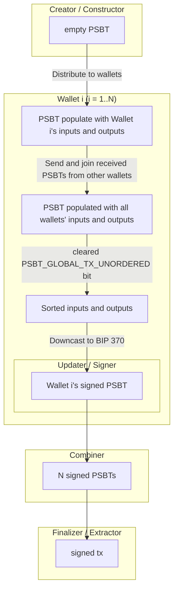

# Concurrent PSBT Construction

## Abstract

New fields and rules for combining PSBTs in a distributed setting. This provides an alternative to the BIP 370 constructor role that is less sensitive to order of operations and therefore more amenable to concurrency, which reduces the coordination required for collaborative transaction construction.

## Motivation

In a distributed system it is easier to deliver messages without guaranteeing the order of delivery is consistent across nodes. To build a transaction, participants only need to agree on which inputs it spends and which outputs it creates. They don't need to agree on the order in which those inputs and outputs were added. This document defines an order insensitive merging procedure which generalizes the *Combiner* role (defined in BIP 174) to non-identical PSBTs which may still overlap in some of their data. A consistent ordering procedure is also defined for producing a consistent PSBT which can subsequently be manipulated using the normal BIP 174 roles.

## Background

### BIP 174 Combiner

BIP 174 defines *Combiner* functionality. Its purpose is to integrate information add by either the *Updater* or *Signer* roles to divergent copies of a PSBT. According to the specification the combiner is intended for for PSBTs whose underlying unsigned transactions are identical.

### BIP 370 Constructor

BIP 370 introduced a *Constructor* role, which allows signalling that the inputs or outputs of a PSBT are modifiable. Arbitrary mutation of the inputs and outputs is then allowed, but this assumes such state updates are done sequentially. The combiner role is mostly unchanged in BIP 370, and is restricted to only allow combining fields of PSBTs which spend and create the same outputs, and in the same order. This facilitates aggregating signatures from multiple parties in any order, but has limited usefulness during the construction of the PSBT.

### `joinpsbts` vs. the Combiner role

Bitcoin Core additionally implements a `joinpsbts` RPC command which does allow merging unique PSBTs, so long as their spent output sets are disjoint.

`joinpsbts` is not idempotent with respect to inputs (writing it as $+$, idempotence would mean that $A + A = A$). Attempting to join a PSBT more than once fails closed: if $B$ contains an input, and $A + B$ is defined, then $(A + B) + B$ will fail, because a transaction cannot spend the same coin twice.

`joinpsbts` is also not idempotent with respect to the outputs, potentially leading to overspending: if $B$ contains just an output, then $B + B$ will contain two copies of that output.

Although not strictly associative or commutative, due to use of shuffling, in regards to transaction effects it does hold that $(A + B) + C = A + (B + C)$ and that $A + B = B + A$.

## Specification

The new field types for distributed PSBT construction are as follows:

### New global types

| Name | `keytype` | `keydata` | `keydata` Description | `valuedata` | `valuedata` Description |
| --- | --- | --- | --- | --- | --- |
| Transaction Unordered Flag | `PSBT_GLOBAL_TX_UNORDERED = TBD` | None | No key data | `<8-bit uint>` | If present, must be set to a value `0x03` to indicate inputs and outputs are unordered. |
| Sort Seed | `PSBT_GLOBAL_SORT_SEED = TBD` | None | No key data | `<bytes globalseed>` | Random seed used to derive deterministic sort keys when explicit per-map sort keys are absent. |
| Deterministic Sort Flag | `PSBT_GLOBAL_SORT_DETERMINISTIC = TBD` | None | No key data | `<8-bit uint>` | A value of `0x01` indicates sort keys must be deterministically derived and explicit `PSBT_IN_SORT_KEY` / `PSBT_OUT_SORT_KEY` fields are disallowed. A value of `0x00` indicates sort keys are required and `PSBT_GLOBAL_SORT_SEED` is disallowed. |

### New per-input types

| Name | `keytype` | `keydata` | `keydata` Description | `valuedata` | `valuedata` Description |
| --- | --- | --- | --- | --- | --- |
| Input Sort Key | `PSBT_IN_SORT_KEY = TBD` | None | No key data | `<bytes sort key>` | Arbitrary lexicographically comparable value used to order inputs. |
| Input Unique ID | `PSBT_IN_UNIQUE_ID = TBD` | None | No key data | `<bytes unique id>` | Optional unique suffix for outpoint identity, used for input removal extensions. |

### New per-output types

| Name | `keytype` | `keydata` | `keydata` Description | `valuedata` | `valuedata` Description |
| --- | --- | --- | --- | --- | --- |
| Output Unique ID | `PSBT_OUT_UNIQUE_ID = TBD` | None | No key data | `<bytes unique id>` | Universally unique identifier for output map identity under unordered output semantics. |
| Output Sort Key | `PSBT_OUT_SORT_KEY = TBD` | None | No key data | `<bytes sort key>` | Arbitrary lexicographically comparable value used to order outputs when transitioning from unordered to ordered mode. |

Example collaborative protocol (*N* wallets). **Creator** and **Constructor** share an empty PSBT with every wallet. Each wallet *i* runs the same pipeline below in parallel. **Combiner**, **Finalizer**, and **Extractor** fan in once all wallets have signed.

#### Strict Combiner

BIP 174 lets a Combiner resolve a key that has two different values by picking either one. That is safe when every copy shares the same unsigned transaction, because the worst outcome is an invalid signature. Once inputs and outputs can differ between copies, picking one value can silently change what the transaction spends or pays, and the result depends on the order in which copies were combined.

A strict Combiner therefore MUST fail when the same key has conflicting values, whenever bit 0 or bit 1 of `PSBT_GLOBAL_TX_MODIFIABLE` is set. With this rule, the transaction effects of combining a set of PSBTs don't depend on the order or grouping of the combinations, or on whether a PSBT is combined more than once. The following sections define exceptions that keep these properties.

##### Combining unique PSBTs

When `PSBT_GLOBAL_TX_UNORDERED` is set, the input or output maps are not distinguished by their index, but instead by a unique identifier defined for each input or output.

Inputs or outputs with identical unique IDs are merged by combining their key-value pairs with the stricter, idempotent combination defined above. After merging the inputs and outputs that appear in both PSBTs, the strict combiner additionally keeps the ones that appear in only one of them.

Distinct identifiers are only allowed if the corresponding `PSBT_GLOBAL_TX_MODIFIABLE` flag is set, because such combinations represent additions of inputs or outputs. If this is not the case but a distinct input or output is present, then combining must fail.

##### Unique identifiers for inputs

Inputs are identified by their outpoint, i.e. the tuple of their `PSBT_IN_PREVIOUS_TXID` and `PSBT_IN_OUTPUT_INDEX`, both of which must be set.

##### Unique identifiers for outputs

Outputs are identified by a new `PSBT_OUT_UNIQUE_ID` field, which must be universally unique (e.g. 16 bytes of randomness).

This ensures that repeated addition of the same output is idempotent, but that if two different distributed constructors both attempt to add an identical output (same `PSBT_OUT_VALUE` and `PSBT_OUT_SCRIPT`), that will still result in two copies of the output as intended. This is important because a transaction with only a single copy will appear correct but end up losing the value of all missing copies to mining fees.

// TODO: if we merge two output how do we decide which id identifies the new one with the usmmer value?
Outputs with an identical `PSBT_OUT_SCRIPT` MAY be merged, and their values summed together after `PSBT_GLOBAL_TX_UNORDERED` is cleared and an order is determined, using BIP 370 construction rules. See the next section on ordering.

### Unordered input and output sets

Reordering a transaction's inputs or outputs does not change which coins it spends or which payments it creates. Treating them as unordered sets, rather than ordered lists, is what lets us combine PSBTs that are not identical.

To represent this we define a global field `PSBT_GLOBAL_TX_UNORDERED`, indicating whether the order of inputs and outputs should be ignored. The value is an unsigned 8 bit integer and if present must be set to `0x03`, indicating the transaction in unordered.

Since there is no known use case that requires input or output to be marked unordered or ordered separately from each other, that is omitted from the spec. The value `0x03` simplifies forward compatibility with any specification that might amend this by allowing either bit to be set independently, so long as it overlaps with this specification when both are set.

Unordered PSBTs MUST be shuffled prior to reserialization. If all inputs and outputs have [sort keys](#ordering-inputs-and-outputs), the key based ordering may be used instead of shuffling.

Not shuffling presents a privacy hazard, leaking information about the sequence of actions leading to a transaction's construction. When a transaction is unordered, shuffling by definition doesn't change its meaning, but ensures the incidental order can't accidentally be relied upon.

### Ordering inputs and ouputs

- TODO: unique ID can be derived by sorting even if sort key is empty, but txn finalization must not be unless all sort keys are provided explicitly (regardless of DETERMINISTIC)

Clearing the `PSBT_GLOBAL_TX_UNORDERED` field indicates the order of the inputs and outputs. Due to the shuffling requirement, the given order will in general not be consistent across replicas if this is done without determining an order, resulting in diverging unsigned transactions.

For consistent ordering we define `PSBT_IN_SORT_KEY` and `PSBT_OUT_SORT_KEY` fields for inputs and outputs respectively, that may include up to 32 bytes of arbitrary data, used as a sort key for lexicographical sorting.

If the global field `PSBT_GLOBAL_SORT_DETERMINISTIC` is set (unsigned 8 bit integer) to `0x01`, then sort keys MUST NOT be set, and `PSBT_GLOBAL_SORT_SEED` MUST be set and contain at least 128 bits of randomness.

// TODO: and sort key must not be set? and you have both PSBT_GLOBAL_SORT_DETERMINISTIC and SORT_SEED?
If `PSBT_GLOBAL_SORT_DETERMINISTIC` is set to `0x00`, explicit sort keys are required to be set and used to sort the prior to clearing the `PSBT_GLOBAL_TX_UNORDERED` field and fixing the transaction order.

If any `PSBT_IN_SORT_KEY` and `PSBT_OUT_SORT_KEY` are omitted, the global `PSBT_GLOBAL_SORT_SEED` field is set, and `PSBT_GLOBAL_SORT_DETERMINISTIC` is either omitted or set to `0x01`, the sort keys are derived deterministically.

A missing `PSBT_IN_SORT_KEY` is derived as:

- `H(PSBT_GLOBAL_SORT_SEED || PSBT_IN_PREVIOUS_TXID || PSBT_IN_OUTPUT_INDEX)` for the inputs
- `PSBT_OUT_SORT_KEY` as `H(PSBT_GLOBAL_SORT_SEED || PSBT_OUT_UNIQUE_ID)` for the outputs

where `H_s` is a BIP 341 style tagged hash, with the tag preimage being `BIP ???? deterministic ordering` (TODO pick a real domain separator).

If any sort key is missing, ordering can only proceed after `PSBT_GLOBAL_SORT_SEED` is set.
If `PSBT_GLOBAL_SORT_SEED` is set and an individual field-level sort seed is set. The inidivudal sort seed will be ignored and replaced by the determinsitic key defined above.

A *Creator* creating an unordered transaction SHOULD set `PSBT_GLOBAL_SORT_DETERMINISTIC` to enure consistent ordering rules are enforced.

In applications where this is desirable, the *Creator* should only set `PSBT_GLOBAL_SORT_DETERMINISTIC` to `0x01`, and leave `PSBT_GLOBAL_SORT_SEED` unset. Each replica will locally provide a value for `PSBT_GLOBAL_SORT_SEED` just in time, as a commitment to protocol transcript or something similar.

If that is not the case, the *Creator* should initialize `PSBT_GLOBAL_SORT_SEED` with sufficient randomness thereby ensure some order can always be determined, or set `PSBT_GLOBAL_SORT_DETERMINISTIC` to `0x00` to indicate explicit sort keys are required.

// TODO move to footer.
For sufficiently large transactions the ordering itself (and therefore the per input signatures) is a cryptographically binding commitment to the `PSBT_GLOBAL_SORT_SEED` value. This is because the entropy of the ordering of $n$ elements is $log_2(n!)$. For reference, $\log_2(35!) > 128$, $\log_2(25!) > 80$, and $\log_2(15!) > 40$.

This can provides additional integrity to a collaborative transaction construction protocol, since [`SIGHASH_ALL`](#divergence-and-sighash-flags) signatures must agree on the ordering.

### Unique identification

A canonical ID MAY be needed to if replicas are attempting to tell if they are holding the same PSBT.
For unordered transactions (i.e `PSBT_GLOBAL_TX_UNORDERED` is set), the `PSBT_GLOBAL_SORT_SEED` and `PSBT_IN_SORT_KEY` and `PSBT_OUT_SORT_KEY` fields are cleared, and then the ordering procedure of the previous section is used without the restriction of a non-empty `PSBT_GLOBAL_SORT_SEED` (sorting with an empty seed).

In the case the PSBT is ordered, its the same prodcedure just no sorting.

TODO: domain separation from PSBT v2, it doesn't make sense to treat an ordered BIP 370 PSBT as the same PSBT even if it agrees on its content when it doesn't agree that the order is meaningless. how to do this? hashing output unique IDs of outputs is insufficient for domain separation of input only partially constructed PSBTs, but maybe that's OK.

### Divergence and SIGHASH flags

Signers MUST sign only using `SIGHASH_ALL`.

If a signer uses `SIGHASH_ANYONECANPAY` or `SIGHASH_NONE`, the signature stays valid for a family of transactions that do not have the same effects.

That at least makes the txid malleable, so it cannot be used with any protocol that needs pre-signed descendant transactions.

Those transactions can also differ enough in what they spend or pay that funds can be lost, not only because someone is cheating, but even because a contribution was left out. `SIGHASH_ALL` commits to the full output list, so a signature cannot authorize a transaction the signer did not intend.

Rationale: No known use cases for these flags in true multiparty transactions (three or more parties). If necessary, a carve out can be specified in a separate document (e.g. for kickstarter-style crowdfunding with `SIGHASH_ANYONECANPAY|SIGHASH_ALL` signing).

#### Mutually exclusive inputs

Two `OP_CLTV` encumbered coins, one with a height based and one with a time based `nLocktime` constraint will impose mutually exclusive validity requirements on their spending transactions, and therefore cannot be spent together in the same transaction.

In order to ensure the least upper bound of any two inputs under consideration not only can be defined, but will correspond to a valid transaction, the *Creator* role can restrict the domain of spendable inputs before inputs are added.

TODO `PSBT_GLOBAL_{REQUIRED,MAXIMUM}_{HEIGHT,TIME}_LOCKTIME` height and time separately or just integer range? separately is consistent with other PSBT specs. a single nlocktime interval field with two unsigned integers, required and max-required would make many invalid states unrepresentable, but is more fiddly and unfamiliar.

## Rationale

TODO global sort seed || hash of fee contributions or expect application to commit to that in transcript if appropriate?

## Backwards Compatibility

## Reference Implementation
